# DỰ BÁO TỐC ĐỘ GIAO THÔNG BẰNG GRU VÀ T-GCN: TÁI LẬP, PHẢN BIỆN VÀ CẢI TIẾN

*Bài tập lớn Khai phá dữ liệu — Đề tài: Dự báo tốc độ giao thông dựa trên mô hình GRU và T-GCN (Los-loop, SZ-taxi). Mọi số liệu trong báo cáo được sinh tự động từ thí nghiệm thật (thư mục results/ và reports/tables/); không có con số nào được ước đoán.*

## Tóm tắt

Chúng tôi cài đặt lại GRU, GCN và T-GCN (Zhao et al., 2019) bằng PyTorch, chạy trên dữ liệu thật Los-loop (207 cảm biến, 7 ngày, 5 phút/mốc) và SZ-taxi (156 tuyến, 31 ngày, 15 phút/mốc) với **cùng dữ liệu, cùng cách chia train/validation/test theo thời gian (70/10/20), 3 seed**, kèm 4 baseline cổ điển (persistence, HA, HA theo giờ, hồi quy tuyến tính). **Bảng tổng hợp mọi mô hình so với baseline gốc T-GCN (số tốt hơn baseline được in đậm) nằm ngay sau phần tóm tắt.** Thực nghiệm đi theo ba giai đoạn của đề tài: (1) GRU và kiểm tra dữ liệu, (2) T-GCN cùng điều kiện, (3) so sánh sai số, phân tích giờ cao điểm và thử cải tiến (cửa sổ đầu vào, số hidden units, đặc trưng thời gian, residual, ...). Kết quả chính trên Los-loop:

1. **GRU tái lập đúng bài báo** (RMSE "15 phút" 5.217 so với 5.218 của bài báo), **T-GCN thì không vượt GRU**: RMSE TB 12 tầm 7.516 ± 0.031 so với 7.495 ± 0.006 (Diebold–Mariano p = 0.76), MAE kém hơn (4.37 so với 4.18). Đồ thị chỉ có lợi ở tầm 45–60 phút, khi tốc độ biến động mạnh và khi dữ liệu nhiễu.
2. **Cơ chế:** chuẩn hóa D^(-1/2)(A+I)D^(-1/2) chỉ để lại ~30% trọng số cho tín hiệu của chính nút ⇒ T-GCN dự báo tầm ngắn kém cả persistence (5 phút: RMSE 4.86 so với 4.45). Ba bằng chứng độc lập: thí nghiệm liều–đáp ứng với trọng số self-loop, permutation importance, gradient saliency. Khi tách riêng trọng số "bản thân / láng giềng" ([x, Âx]W), T-GCN **tốt hơn GRU có ý nghĩa thống kê** (7.30 ± 0.06 so với 7.50, p = 0.01) — đồ thị có ích nếu không xóa mờ thông tin riêng của nút.
3. **Phản biện bài báo:** chọn epoch bằng tập test (đo trên 37 run: làm sai số đẹp hơn trung bình 1.1%, tới 5.6% với mô hình dễ quá khớp — cùng cỡ lợi thế 1.8% mà bài báo báo cáo cho T-GCN), "15/30/45/60 phút" là sai số gộp các bước, không có baseline persistence (persistence có MAE "15 phút" 3.16 < 3.18 của T-GCN), không có độ biến thiên, kết luận "tốt nhất trên mọi chỉ số" mâu thuẫn với MAE trong chính Bảng 1.
4. **Giờ cao điểm là điểm yếu chung:** trong giờ cao điểm persistence có MAE thấp nhất (cả 15 và 60 phút); chỉ khi tốc độ biến động mạnh, các mô hình có đồ thị mới vượt trội; mọi mô hình học sâu dự báo lạc quan ~9 mph khi tốc độ ≤ 20 mph; khoảng dự báo conformal 90% chỉ phủ 69–79% trong cao điểm.
5. **Cải tiến hiệu quả nhất là cách đặt bài toán, không phải đồ thị:** học phần thay đổi so với giá trị cuối (residual) + đặc trưng giờ/thứ. GRU-RT giảm RMSE 6.9% so với GRU (p < 0.001); ensemble 3 seed đạt "15 phút" 5.09 / 3.01 và "60 phút" 6.91 / 4.01 — tốt hơn mọi con số của bài báo (T-GCN: 5.13 / 3.18 và 7.27 / 4.60) dù dùng giao thức chặt hơn. Siêu tham số (cửa sổ 6–24 bước, hidden 32–100) chỉ thay đổi kết quả ≤ 1.3%.
6. **Độ tin cậy:** các cấu hình chính rất ổn định theo seed (CV ≤ 1%), và chọn cấu hình theo validation cho cùng thứ hạng như trên test; nhưng mô hình residual rất nhạy với cảm biến hỏng (5% đầu vào = 0 làm RMSE tăng 33–64%) ⇒ cần bước kiểm tra dữ liệu khi triển khai.

**Trên SZ-taxi** (dữ liệu taxi nhiễu, 25% giá trị thiếu), kết luận chính được lặp lại: T-GCN kém GRU có ý nghĩa (4.23 so với 4.18 RMSE), và cả hai chỉ hơn trung bình trượt 3 giờ ~1–3%; baseline HA trong bài báo cho SZ-taxi (7.92) yếu gần gấp đôi một trung bình trượt đúng nghĩa (4.17). Residual không giúp trên dữ liệu nhiễu — cải tiến phải phù hợp tính chất dữ liệu.

**Cải tiến nâng cao (mục 11).** Áp dụng thêm kiến trúc hiện đại (STID, DCRNN, Graph WaveNet, STAEformer), một mô hình khai phá dữ liệu cổ điển (LightGBM với ~50 đặc trưng không gian–thời gian) và trộn theo từng tầm dự báo với trọng số học trên validation:

7. **Kết quả tốt nhất: trộn LightGBM + Graph WaveNet-residual theo tầm, RMSE 6.19 / MAE 3.49 trên Los-loop** — giảm 18% RMSE và 20% MAE so với T-GCN gốc, 10% so với ensemble GRU-RT (p = 0.0002); theo cách tính của bài báo: "15 phút" 4.74 / 2.75 và "60 phút" 6.19 / 3.49 so với 5.13 / 3.18 và 7.27 / 4.60 của T-GCN trong bài báo. Trên SZ-taxi: trộn STID + LightGBM 4.40 / 3.11 (mục tiêu ≠ 0), giảm 4.7% so với GRU và 6.2% so với T-GCN gốc.
8. **Chìa khóa là kiến thức miền, không phải kiến trúc:** đặc trưng quan trọng nhất là *hồ sơ tốc độ theo khung giờ của từng cảm biến* (~50–65% tầm quan trọng). Nhờ nó, giờ cao điểm — điểm yếu ở trên — được khắc phục: lần đầu có mô hình thắng persistence trong cao điểm ở 15 phút, và giảm 19% MAE ở 60 phút.
9. **Kiến trúc hiện đại: phụ thuộc dữ liệu và cách đặt bài toán.** Trên Los-loop (5 ngày train), STID và DCRNN-lite quá khớp (7.43, 7.56), còn **Graph WaveNet + residual là mạng nơ-ron tốt nhất (6.59 / 3.67)**; trên SZ-taxi (22 ngày) các mô hình tự học hồ sơ theo giờ (STID, Graph WaveNet) lại dẫn đầu. **Chạy trên GPU** (7 cấu hình × 3 seed × 2 bộ dữ liệu; số liệu đã kiểm tra, khớp tuyệt đối — mục 11.8): cỡ đầy đủ theo bài gốc không tốt hơn cỡ gọn; STAEformer quá khớp và không ổn định trên Los-loop (cỡ đầy đủ 7.22 ± 0.43, cỡ gọn còn kém T-GCN gốc); Graph WaveNet + residual tái lập đúng kết quả CPU (6.565 ± 0.052); trên SZ-taxi Graph WaveNet (GPU) là mô hình đơn tốt nhất (4.428, −5.7% so với T-GCN gốc), ngang STID. Dữ liệu lớn (METR-LA / PEMS-BAY) là bước tiếp theo: `LOCAL_RUN.md`.

**Mục lục:** Bảng tổng hợp so với baseline gốc · 1. Ý tưởng · 2. Dữ liệu & kiểm tra dữ liệu · 3. Phương pháp · 4. Phản biện bài báo · 5. Kết quả 3 giai đoạn · 6. Mô hình huấn luyện được & cách dùng · 7. Minh chứng – giải thích cơ chế · 8. Độ tin cậy · 9. So sánh với bài báo · 10. SZ-taxi · 11. Cải tiến nâng cao: mô hình hiện đại, LightGBM, trộn theo tầm, các lần chạy GPU · 12. Hạn chế & hướng phát triển · 13. Kết luận


## Bảng tổng hợp: mọi mô hình so với baseline gốc (T-GCN)

**Baseline gốc** là mô hình T-GCN của Zhao et al. (2019) — mô hình mà đề tài tái lập. Vì có hai cách chấm điểm nên có hai bảng cho mỗi bộ dữ liệu, mỗi bảng một baseline:

1. **Theo cách tính của bài báo** ("15/30/45/60 phút" = sai số gộp các bước 1…k; RMSE, MAE, Accuracy, R²). Baseline là **con số T-GCN in trong Bảng 1 của bài báo**. Bảng này trả lời câu hỏi "có vượt con số đã công bố không?" — lưu ý tác giả chọn epoch theo tập test và chia 80/20 (mục 4), nên đây là so với một mốc *lạc quan*.
2. **Theo giao thức nghiêm ngặt** (70/10/20, chọn epoch theo validation, 3 seed, sai số tại đúng từng bước). Baseline là **T-GCN gốc do chúng tôi tái lập** — cùng dữ liệu, cùng cách chia, cùng các cửa sổ test với mọi mô hình khác. Đây là so sánh công bằng.

**Quy ước cho mọi bảng so sánh trong báo cáo:** dòng baseline được đánh dấu *baseline*; **số in đậm = tốt hơn baseline ở cùng cột** (RMSE, MAE thấp hơn; Accuracy, R² cao hơn), so ở đúng số chữ số hiển thị nên hai số bằng nhau trên bảng không được in đậm; Δ = thay đổi tương đối so với baseline (âm = sai số giảm). Các dòng "(GPU)" là các lần chạy trên GPU máy của bạn (7 cấu hình × 3 seed × 2 bộ dữ liệu, mục 11.8); chỉ số "kiểu bài báo" của chúng được tính chính xác từ sai số từng bước (mục 11.8).

### Los-loop — cách tính của bài báo (baseline: T-GCN trong Bảng 1)

| Mô hình | nguồn | "15 phút" | "30 phút" | "45 phút" | "60 phút" | Δ "60 phút" RMSE / MAE |
|---|---|---|---|---|---|---|
| T-GCN — số trong bài báo — *baseline* | Bảng 1 bài báo | 5.126 / 3.180 / 0.913 / 0.863 | 6.060 / 3.747 / 0.897 / 0.810 | 6.707 / 4.116 / 0.886 / 0.768 | 7.268 / 4.602 / 0.876 / 0.728 | — |
| GRU — số trong bài báo | Bảng 1 bài báo | 5.218 / **3.060** / 0.911 / 0.858 | 6.280 / **3.651** / 0.893 / 0.796 | 7.034 / **4.091** / 0.880 / 0.745 | 7.662 / **4.519** / 0.869 / 0.698 | +5.4% / -1.8% |
| Persistence (giữ giá trị cuối) | chạy lại (CPU) | 5.558 / **3.149** / 0.905 / 0.839 | 6.710 / **3.628** / 0.886 / 0.766 | 7.621 / **4.033** / 0.870 / 0.698 | 8.418 / **4.408** / 0.857 / 0.631 | +15.8% / -4.2% |
| GRU | chạy lại (CPU) | 5.217 / **2.965** / 0.911 / 0.858 | 6.181 / **3.443** / 0.895 / 0.801 | 6.899 / **3.833** / 0.883 / 0.752 | 7.495 / **4.175** / 0.872 / 0.707 | +3.1% / -9.3% |
| T-GCN gốc (tái lập) | chạy lại (CPU) | 5.552 / 3.361 / 0.905 / 0.840 | 6.363 / 3.749 / 0.892 / 0.789 | 6.996 / **4.082** / 0.881 / 0.745 | 7.516 / **4.371** / 0.872 / 0.706 | +3.4% / -5.0% |
| T-GCN tách self/láng giềng | chạy lại (CPU) | **5.103** / **2.983** / 0.913 / **0.865** | **6.034** / **3.437** / 0.897 / 0.810 | 6.733 / **3.805** / 0.885 / 0.764 | 7.295 / **4.124** / 0.876 / 0.723 | +0.4% / -10.4% |
| GRU-RT (residual + giờ) | chạy lại (CPU) | 5.135 / **3.052** / 0.913 / 0.863 | **5.958** / **3.472** / **0.899** / **0.815** | **6.529** / **3.791** / **0.889** / **0.778** | **6.981** / **4.065** / **0.881** / **0.746** | -3.9% / -11.7% |
| Ensemble GRU-RT (3 seed) | chạy lại (CPU) | **5.090** / **3.008** / 0.913 / **0.865** | **5.905** / **3.425** / **0.899** / **0.819** | **6.466** / **3.740** / **0.890** / **0.782** | **6.911** / **4.012** / **0.882** / **0.751** | -4.9% / -12.8% |
| STID | chạy lại (CPU) | 5.416 / 3.203 / 0.908 / 0.847 | 6.314 / **3.611** / 0.892 / 0.792 | 6.944 / **3.919** / 0.882 / 0.749 | 7.427 / **4.156** / 0.874 / 0.712 | +2.2% / -9.7% |
| DCRNN-lite + residual (1 seed) | chạy lại (CPU) | 5.368 / 3.251 / 0.909 / 0.850 | 6.301 / **3.691** / 0.893 / 0.793 | 7.011 / **4.065** / 0.881 / 0.744 | 7.560 / **4.387** / 0.871 / 0.702 | +4.0% / -4.7% |
| Graph WaveNet + residual (CPU) | chạy lại (CPU) | **4.910** / **2.860** / **0.916** / **0.875** | **5.699** / **3.221** / **0.903** / **0.831** | **6.212** / **3.475** / **0.894** / **0.799** | **6.589** / **3.674** / **0.888** / **0.774** | -9.3% / -20.2% |
| Graph WaveNet + residual (GPU) | chạy lại (GPU của bạn) | **4.916** / **2.911** / **0.916** / **0.874** | **5.675** / **3.270** / **0.903** / **0.832** | **6.178** / **3.529** / **0.895** / **0.801** | **6.565** / **3.741** / **0.888** / **0.775** | -9.7% / -18.7% |
| Graph WaveNet + residual, cỡ đầy đủ (GPU) | chạy lại (GPU của bạn) | **4.938** / **2.883** / **0.916** / **0.873** | **5.745** / **3.258** / **0.902** / **0.828** | **6.282** / **3.525** / **0.893** / **0.794** | **6.685** / **3.736** / **0.886** / **0.767** | -8.0% / -18.8% |
| STAEformer cỡ đầy đủ (GPU) | chạy lại (GPU của bạn) | 5.712 / 3.363 / 0.903 / 0.830 | 6.358 / **3.638** / 0.892 / 0.789 | 6.829 / **3.857** / 0.884 / 0.757 | **7.220** / **4.051** / **0.877** / 0.728 | -0.7% / -12.0% |
| LightGBM v2 (đặc trưng KG–TG) | chạy lại (CPU) | **4.912** / **2.815** / **0.916** / **0.875** | **5.676** / **3.172** / **0.903** / **0.832** | **6.132** / **3.410** / **0.896** / **0.804** | **6.467** / **3.595** / **0.890** / **0.782** | -11.0% / -21.9% |
| Trộn theo tầm: LightGBM + Graph WaveNet-res (+ GRU-RT) — mô hình cuối | chạy lại (CPU) | **4.736** / **2.753** / **0.919** / **0.883** | **5.427** / **3.082** / **0.908** / **0.847** | **5.858** / **3.310** / **0.900** / **0.821** | **6.190** / **3.494** / **0.895** / **0.800** | -14.8% / -24.1% |

*Mỗi ô: RMSE / MAE / Accuracy / R², tính như bài báo (sai số gộp các bước 1…k; tầm k = 3, 6, 9, 12 bước 5 phút). Δ = thay đổi so với baseline (âm là tốt hơn).*

*Số in đậm = tốt hơn T-GCN trong Bảng 1 của bài báo (dòng baseline) ở cùng cột, so ở đúng số chữ số hiển thị; RMSE, MAE thấp hơn và Accuracy, R² cao hơn là tốt hơn.*

### Los-loop — giao thức nghiêm ngặt (baseline: T-GCN gốc tái lập)

| Mô hình | chạy trên | seed | RMSE TB 12 tầm | MAE TB 12 tầm | 5 phút | 15 phút | 30 phút | 60 phút | Δ RMSE / MAE |
|---|---|---|---|---|---|---|---|---|---|
| Persistence (giữ giá trị cuối) | CPU | 1 | 8.418 | 4.408 | **4.45** / **2.69** | 6.45 / **3.56** | 8.22 / 4.37 | 10.85 / 5.77 | +12.0% / +0.9% |
| GRU | CPU | 3 | **7.495** ± 0.006 | **4.175** ± 0.023 | **4.24** / **2.53** | **6.00** / **3.36** | **7.44** / **4.18** | 9.32 / **5.38** | -0.3% / -4.5% |
| T-GCN gốc (tái lập) — *baseline* | CPU | 3 | 7.516 ± 0.031 | 4.371 ± 0.037 | 4.86 / 3.04 | 6.16 / 3.67 | 7.47 / 4.36 | 9.13 / 5.39 | — |
| T-GCN tách self/láng giềng | CPU | 3 | **7.295** ± 0.060 | **4.124** ± 0.019 | **4.20** / **2.59** | **5.83** / **3.35** | **7.26** / **4.14** | **9.00** / **5.24** | -2.9% / -5.7% |
| GRU-RT (residual + giờ) | CPU | 3 | **6.981** ± 0.063 | **4.065** ± 0.063 | **4.23** / **2.63** | **5.84** / **3.43** | **7.02** / **4.10** | **8.39** / **5.04** | -7.1% / -7.0% |
| Ensemble GRU-RT (3 seed) | CPU | gộp 3 seed | **6.911** | **4.012** | **4.19** / **2.59** | **5.80** / **3.38** | **6.95** / **4.05** | **8.29** / **4.97** | -8.1% / -8.2% |
| STID | CPU | 3 | **7.427** ± 0.205 | **4.156** ± 0.126 | **4.51** / **2.79** | **6.15** / **3.51** | 7.50 / **4.21** | **8.81** / **5.01** | -1.2% / -4.9% |
| DCRNN-lite + residual (1 seed) | CPU | 1 | 7.560 | 4.387 | **4.45** / **2.85** | **6.12** / **3.63** | 7.53 / **4.35** | 9.19 / 5.44 | +0.6% / +0.4% |
| Graph WaveNet + residual (CPU) | CPU | 3 | **6.589** ± 0.117 | **3.674** ± 0.035 | **4.03** / **2.47** | **5.60** / **3.20** | **6.69** / **3.75** | **7.75** / **4.35** | -12.3% / -15.9% |
| Graph WaveNet + residual (GPU) | GPU của bạn | 3 | **6.565** ± 0.052 | **3.741** ± 0.041 | **4.08** / **2.55** | **5.58** / **3.23** | **6.64** / **3.79** | **7.78** / **4.49** | -12.7% / -14.4% |
| Graph WaveNet + residual, cỡ đầy đủ (GPU) | GPU của bạn | 3 | **6.685** ± 0.129 | **3.736** ± 0.062 | **4.07** / **2.50** | **5.63** / **3.22** | **6.77** / **3.81** | **7.93** / **4.46** | -11.1% / -14.5% |
| STAEformer cỡ đầy đủ (GPU) | GPU của bạn | 3 | **7.220** ± 0.431 | **4.051** ± 0.173 | 5.11 / 3.15 | 6.20 / **3.55** | **7.24** / **4.06** | **8.45** / **4.74** | -3.9% / -7.3% |
| LightGBM v2 (đặc trưng KG–TG) | CPU | 3 | **6.467** ± <0.001 | **3.595** ± 0.005 | **3.97** / **2.41** | **5.66** / **3.19** | **6.60** / **3.68** | **7.48** / **4.22** | -14.0% / -17.7% |
| Trộn theo tầm: LightGBM + Graph WaveNet-res (+ GRU-RT) — mô hình cuối | CPU | gộp 3 seed | **6.190** | **3.494** | **3.91** / **2.39** | **5.37** / **3.08** | **6.29** / **3.56** | **7.20** / **4.11** | -17.6% / -20.1% |

*"5 phút … 60 phút" = RMSE / MAE tại đúng bước đó; ± = độ lệch chuẩn giữa các seed. Δ so với T-GCN gốc (âm là tốt hơn).*

*Số in đậm = tốt hơn T-GCN gốc tái lập, TB 3 seed (dòng baseline) ở cùng cột, so ở đúng số chữ số hiển thị; sai số thấp hơn là tốt hơn.*

### SZ-taxi — cách tính của bài báo (baseline: T-GCN trong Bảng 1)

| Mô hình | nguồn | "15 phút" | "30 phút" | "45 phút" | "60 phút" | Δ "60 phút" RMSE / MAE |
|---|---|---|---|---|---|---|
| T-GCN — số trong bài báo — *baseline* | Bảng 1 bài báo | 3.916 / 2.706 / 0.731 / 0.854 | 3.962 / 2.745 / 0.728 / 0.852 | 3.995 / 2.767 / 0.725 / 0.851 | 4.014 / 2.789 / 0.724 / 0.850 | — |
| GRU — số trong bài báo | Bảng 1 bài báo | 4.048 / **2.681** / 0.718 / 0.850 | 4.077 / **2.701** / 0.716 / 0.848 | 4.100 / **2.721** / 0.714 / 0.846 | 4.124 / **2.743** / 0.713 / 0.844 | +2.7% / -1.6% |
| Persistence (giữ giá trị cuối) | chạy lại (CPU) | 5.246 / 3.310 / 0.635 / 0.747 | 5.314 / 3.352 / 0.630 / 0.741 | 5.351 / 3.384 / 0.627 / 0.737 | 5.391 / 3.412 / 0.624 / 0.733 | +34.3% / +22.3% |
| HA (TB 12 bước đầu vào) | chạy lại (CPU) | 4.163 / 2.731 / 0.710 / 0.841 | 4.191 / 2.751 / 0.708 / 0.839 | 4.216 / 2.769 / 0.706 / 0.837 | 4.240 / **2.786** / 0.705 / 0.835 | +5.6% / -0.1% |
| GRU | chạy lại (CPU) | 4.089 / 2.715 / 0.715 / 0.846 | 4.126 / **2.740** / 0.713 / 0.844 | 4.152 / **2.757** / 0.711 / 0.842 | 4.179 / **2.775** / 0.709 / 0.840 | +4.1% / -0.5% |
| T-GCN gốc (tái lập) | chạy lại (CPU) | 4.156 / 2.782 / 0.710 / 0.841 | 4.182 / 2.798 / 0.709 / 0.839 | 4.204 / 2.812 / 0.707 / 0.838 | 4.225 / 2.825 / 0.706 / 0.836 | +5.2% / +1.3% |
| STID (CPU) | chạy lại (CPU) | 3.989 / **2.673** / 0.722 / 0.854 | 4.016 / **2.699** / 0.720 / 0.852 | 4.036 / **2.719** / 0.719 / 0.850 | 4.052 / **2.734** / 0.718 / 0.849 | +0.9% / -2.0% |
| Graph WaveNet (GPU) | chạy lại (GPU của bạn) | 3.971 / **2.640** / 0.723 / **0.855** | 3.994 / **2.662** / 0.722 / **0.854** | 4.008 / **2.673** / 0.721 / **0.853** | 4.019 / **2.680** / 0.720 / **0.852** | +0.1% / -3.9% |
| Graph WaveNet cỡ đầy đủ (GPU) | chạy lại (GPU của bạn) | 3.970 / **2.636** / 0.723 / **0.855** | 3.993 / **2.655** / 0.722 / **0.854** | 4.009 / **2.667** / 0.721 / **0.852** | 4.022 / **2.677** / 0.720 / **0.852** | +0.2% / -4.0% |
| STAEformer (GPU) | chạy lại (GPU của bạn) | 3.980 / **2.659** / 0.723 / **0.855** | 4.001 / **2.675** / 0.721 / **0.853** | 4.016 / **2.680** / 0.720 / **0.852** | 4.029 / **2.689** / 0.719 / **0.851** | +0.4% / -3.6% |
| LightGBM v2 (đặc trưng KG–TG) | chạy lại (CPU) | 4.007 / **2.663** / 0.721 / 0.853 | 4.027 / **2.679** / 0.719 / 0.851 | 4.042 / **2.692** / 0.718 / 0.850 | 4.053 / **2.702** / 0.718 / 0.849 | +1.0% / -3.1% |
| Trộn theo tầm: STID-res + LightGBM (+ GRU-RTP, GRU) — mô hình cuối | chạy lại (CPU) | 3.954 / **2.651** / 0.725 / **0.856** | 3.980 / **2.674** / 0.723 / **0.855** | 3.997 / **2.688** / 0.722 / **0.853** | **4.008** / **2.698** / 0.721 / **0.853** | -0.2% / -3.3% |

*Mỗi ô: RMSE / MAE / Accuracy / R², tính như bài báo (sai số gộp các bước 1…k; mọi mục tiêu kể cả số 0, như bài báo). Δ = thay đổi so với baseline (âm là tốt hơn).*

*Số in đậm = tốt hơn T-GCN trong Bảng 1 của bài báo (dòng baseline) ở cùng cột, so ở đúng số chữ số hiển thị; RMSE, MAE thấp hơn và Accuracy, R² cao hơn là tốt hơn.*

### SZ-taxi — giao thức nghiêm ngặt (baseline: T-GCN gốc tái lập)

| Mô hình | chạy trên | seed | RMSE ≠0 | MAE ≠0 | RMSE (mọi mục tiêu) | MAE (mọi mục tiêu) | 15 phút (mọi mục tiêu) | 60 phút (mọi mục tiêu) | Δ RMSE / MAE (≠0) |
|---|---|---|---|---|---|---|---|---|---|
| Persistence (giữ giá trị cuối) | CPU | 1 | 6.012 | 4.262 | 5.391 | 3.412 | 5.25 / 3.31 | 5.51 / 3.49 | +28.1% / +27.4% |
| HA (TB 12 bước đầu vào) | CPU | 1 | 4.743 | 3.372 | 4.240 | **2.786** | 4.16 / **2.73** | 4.31 / **2.84** | +1.0% / +0.8% |
| GRU | CPU | 3 | **4.619** ± 0.001 | **3.269** ± 0.002 | **4.179** | **2.775** | **4.09** / **2.72** | **4.26** / **2.83** | -1.6% / -2.3% |
| T-GCN gốc (tái lập) — *baseline* | CPU | 3 | 4.694 ± 0.004 | 3.346 ± 0.004 | 4.225 | 2.825 | 4.16 / 2.78 | 4.29 / 2.86 | — |
| STID (CPU) | CPU | 3 | **4.445** ± 0.009 | **3.140** ± 0.005 | **4.052** | **2.734** | **3.99** / **2.67** | **4.10** / **2.78** | -5.3% / -6.1% |
| Graph WaveNet (GPU) | GPU của bạn | 3 | **4.428** ± 0.011 | **3.131** ± 0.008 | **4.019** | **2.680** | **3.97** / **2.64** | **4.05** / **2.70** | -5.7% / -6.4% |
| Graph WaveNet cỡ đầy đủ (GPU) | GPU của bạn | 3 | **4.436** ± 0.013 | **3.133** ± 0.007 | **4.022** | **2.677** | **3.97** / **2.64** | **4.06** / **2.71** | -5.5% / -6.4% |
| STAEformer (GPU) | GPU của bạn | 3 | **4.443** ± 0.016 | **3.139** ± 0.009 | **4.029** | **2.689** | **3.98** / **2.66** | **4.07** / **2.72** | -5.3% / -6.2% |
| LightGBM v2 (đặc trưng KG–TG) | CPU | 3 | **4.494** ± 0.002 | **3.170** ± 0.001 | **4.053** | **2.702** | **4.01** / **2.66** | **4.09** / **2.73** | -4.3% / -5.2% |
| Trộn theo tầm: STID-res + LightGBM (+ GRU-RTP, GRU) — mô hình cuối | CPU | gộp 3 seed | **4.402** | **3.106** | **4.008** | **2.698** | **3.95** / **2.65** | **4.04** / **2.73** | -6.2% / -7.2% |

*"15 phút", "60 phút" = RMSE / MAE tại đúng bước đó, trên mọi mục tiêu (lần chạy GPU không xuất sai số từng bước trên mục tiêu ≠ 0). Δ so với T-GCN gốc, trên mục tiêu ≠ 0.*

*Số in đậm = tốt hơn T-GCN gốc tái lập, TB 3 seed (dòng baseline) ở cùng cột, so ở đúng số chữ số hiển thị; sai số thấp hơn là tốt hơn.*

**Đọc nhanh bốn bảng:**

- **Los-loop, so với con số của bài báo:** năm mô hình tốt hơn T-GCN của bài báo ở **cả 16/16 ô** (4 tầm × 4 chỉ số): mô hình cuối (trộn theo tầm), LightGBM, và cả ba bản Graph WaveNet + residual (CPU, GPU, GPU cỡ đầy đủ); ensemble GRU-RT đạt 15/16 (Accuracy "15 phút" bằng nhau, 0.913). Mô hình cuối giảm **14.8% RMSE và 24.1% MAE** ở "60 phút" (6.190 / 3.494 so với 7.268 / 4.602). Ngược lại, T-GCN gốc tái lập dưới giao thức nghiêm ngặt **không đạt** con số RMSE của bài báo (5.552 so với 5.126 ở "15 phút"; mục 9.2 cho thấy phần lớn chênh lệch đến từ giao thức), chỉ tốt hơn về MAE ở 45–60 phút.
- **Hai dòng tự nó là phản biện:** chính GRU *trong bài báo* và persistence (giữ giá trị cuối, không học gì) đều có **MAE tốt hơn T-GCN của bài báo ở cả 4 tầm** — kết luận "T-GCN tốt nhất trên mọi chỉ số" không đứng vững ngay trên Bảng 1 (mục 4, P4–P5).
- **Los-loop, giao thức nghiêm ngặt:** mọi cải tiến đều tốt hơn T-GCN gốc ở cả 10/10 ô, trừ STID (9/10), STAEformer cỡ đầy đủ chạy GPU (7/10 — thua ở 5 phút và RMSE 15 phút) và DCRNN-lite (5/10, RMSE TB kém hơn 0.6%). Mô hình cuối: **−17.6% RMSE, −20.1% MAE**; mạng nơ-ron tốt nhất là Graph WaveNet + residual (−12.3% / −15.9% trên CPU; −12.7% / −14.4% trên GPU).
- **SZ-taxi, so với con số của bài báo:** khó vượt hơn nhiều vì chuỗi gần như "mức trung bình + nhiễu". Không mô hình nào có RMSE "15 phút" thấp hơn 3.916 của bài báo; chỉ mô hình cuối tốt hơn ở RMSE "60 phút" (4.008 so với 4.014, −0.2%). Nhưng Graph WaveNet / STAEformer chạy GPU và mô hình cuối tốt hơn ở **MAE và R² của cả 4 tầm** (8–9/16 ô; Graph WaveNet: −3.9% MAE). Accuracy (= 1 − ‖Y − Ŷ‖/‖Y‖) và R² (= 1 − SSE/SST) đều phụ thuộc *tập test* qua ‖Y‖ và phương sai của Y, mà tập test của bài báo (80/20) khác của chúng tôi; vì vậy trên SZ-taxi hai chỉ số này còn cho kết luận ngược nhau (R² tốt hơn, Accuracy kém hơn) — chúng chỉ so chặt chẽ được trên cùng tập test như ở bảng dưới.
- **SZ-taxi, giao thức nghiêm ngặt:** mọi mô hình học sâu và LightGBM tốt hơn T-GCN gốc ở 8/8 ô; **Graph WaveNet (GPU) là mô hình đơn tốt nhất (RMSE ≠0 4.428, −5.7%)**, nhỉnh hơn STID (4.445) nhưng chênh lệch (0.017) chưa tới 2 lần độ lệch chuẩn giữa các seed nên chưa đủ để kết luận (mục 11.8); mô hình cuối −6.2% RMSE, −7.2% MAE.


## 1. Ý tưởng

**Bài toán.** Cho tốc độ quan sát được tại N cảm biến (Los-loop: 207 vòng từ trên cao tốc Los Angeles, 5 phút/mốc; SZ-taxi: 156 tuyến đường quận La Hồ – Thâm Quyến, 15 phút/mốc) trong L bước gần nhất, dự báo tốc độ của **toàn bộ mạng** trong H bước tiếp theo (15, 30, 45, 60 phút).

**Ý tưởng của T-GCN (Zhao et al., 2019).** Tốc độ ở một đoạn đường phụ thuộc vào (i) chính quá khứ của nó (phụ thuộc thời gian) và (ii) trạng thái các đoạn đường lân cận (phụ thuộc không gian: ùn tắc lan truyền ngược dòng). GRU mô hình hóa (i); GCN mô hình hóa (ii). T-GCN đặt GCN **vào bên trong các cổng của GRU**: ở mỗi bước, trước khi quyết định "nhớ" hay "ghi đè", mỗi nút tổng hợp thông tin của các nút kề.

**Câu hỏi nghiên cứu của đồ án.** Chúng tôi không chỉ chạy lại mà kiểm chứng bốn giả thuyết:

- **H1 – Đồ thị có ích:** T-GCN tốt hơn GRU (cùng dữ liệu, cùng chia tập, cùng seed).
- **H2 – Học sâu có ích:** GRU/T-GCN tốt hơn các baseline đơn giản, kể cả baseline "giữ nguyên giá trị cuối" (persistence) mà bài báo không so sánh.
- **H3 – Con số của bài báo đáng tin:** giao thức đánh giá của tác giả không làm lạc quan kết quả.
- **H4 – Có thể cải tiến:** điều chỉnh cửa sổ đầu vào, số hidden units, thêm đặc trưng thời gian và học phần thay đổi (residual) giúp giảm sai số, nhất là giờ cao điểm.

## 2. Dẫn dắt — dữ liệu và kiểm tra dữ liệu (giai đoạn 1)

### 2.1 Tổng quan hai bộ dữ liệu

| Thuộc tính | Los-loop | SZ-taxi |
|---|---|---|
| Số mốc × số nút | 2016 × 207 | 2976 × 156 |
| Bước thời gian | 5 phút | 15 phút |
| Khoảng thời gian | 01/03/2012 (thứ Năm) → 07/03/2012 | 01/01/2015 → 31/01/2015 |
| Tốc độ TB ± độ lệch chuẩn | 58.9 ± 12.5 (mph) | 12.2 ± 12.7 |
| Giá trị 0 | 0% | **24.8%** (37 tuyến có > 50% là 0) |
| Đồ thị | 2626 cạnh, bậc TB 12.7, đối xứng, có trọng số theo khoảng cách | 532 cạnh, bậc TB 3.4, **có hướng**, nhị phân |
| Train / Val / Test (70/10/20 theo thời gian) | đến 05/03 21:35 / đến 06/03 14:20 / phần còn lại | đến 22/01 16:45 / đến 25/01 19:00 / phần còn lại |

Dữ liệu không có cột thời gian; chúng tôi dựng mốc thời gian từ ngày bắt đầu theo bài báo. **Kiểm chứng**: hồ sơ tốc độ trung bình theo giờ (Hình 1) cho thấy Los-loop có hai đáy rõ rệt lúc 7–9h và 16–19h vào ngày thường, còn cuối tuần gần như không có — đúng với giờ cao điểm địa phương, nên mốc thời gian dựng lại là hợp lệ và các đặc trưng giờ/thứ có nghĩa.

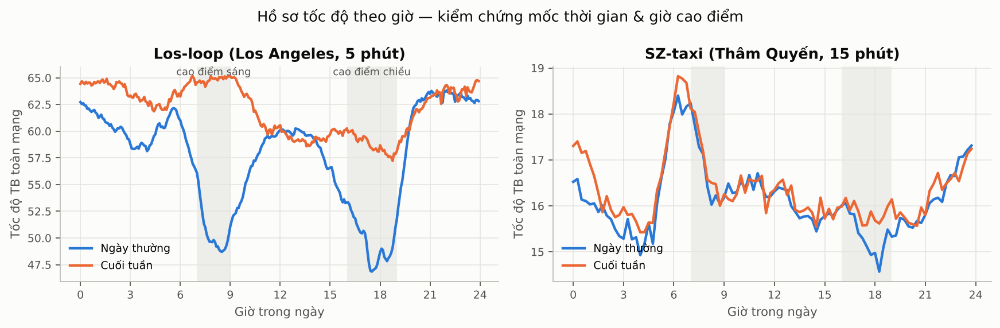

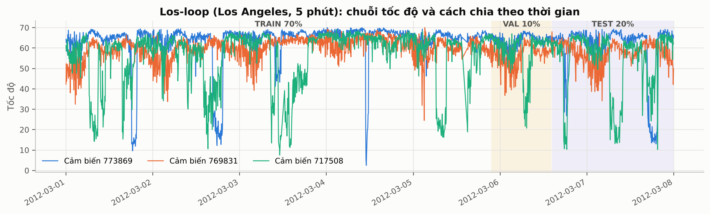

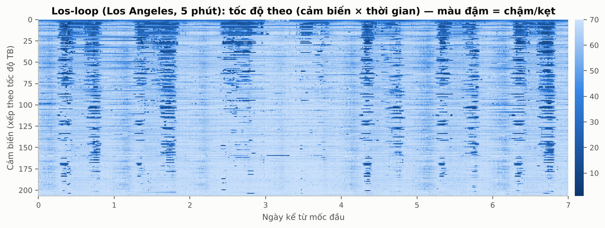

### 2.2 Bằng chứng cho phụ thuộc thời gian và không gian

- **Thời gian (Hình 4):** tự tương quan trung bình của Los-loop là 0.82 ở độ trễ 5 phút, 0.74 ở 15 phút và còn 0.50 ở 60 phút ⇒ cửa sổ 12 bước (60 phút) chứa phần lớn thông tin hữu ích; thông tin gần nhất quan trọng nhất. SZ-taxi chỉ 0.41 ở 15 phút và giảm rất chậm ⇒ chuỗi rất **nhiễu** (tốc độ ước lượng từ một số ít taxi), trung bình trượt sẽ là baseline mạnh.
- **Không gian (Hình 5):** hệ số tương quan giữa hai cảm biến giảm theo khoảng cách trên đồ thị: Los-loop 0.41 (kề trực tiếp) → 0.24 (2 bước) → 0.11 (≥ 10 bước). Đây là cơ sở cho GCN. Tuy nhiên, tương quan của **biến động ngắn hạn** (Δ tốc độ 5 phút) giữa hai nút kề chỉ 0.066 (và ≈ 0 với nút xa): láng giềng cho biết "mức" tốc độ chung của khu vực, nhưng rất ít thông tin về cú sốc kế tiếp. Ta kỳ vọng lợi ích của đồ thị là **có nhưng nhỏ** ở tầm ngắn.

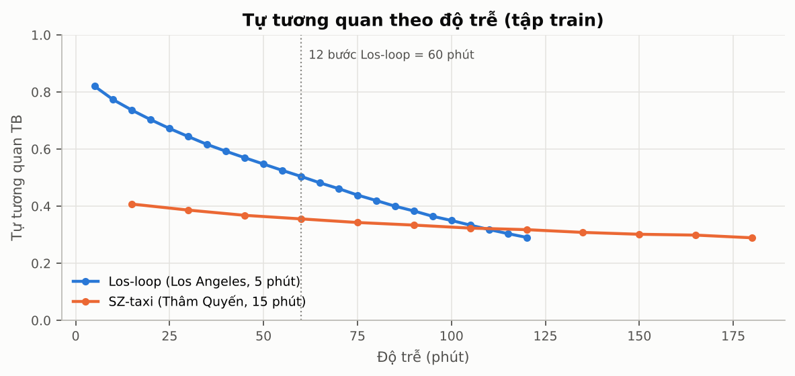

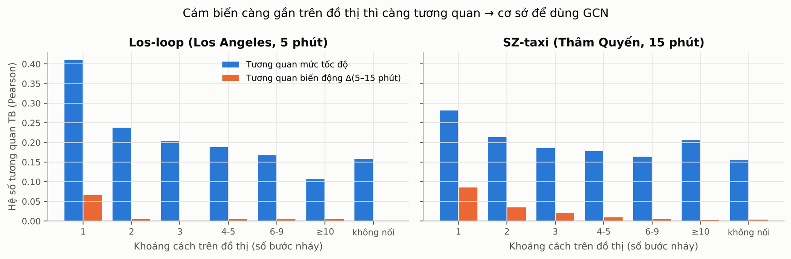

### 2.3 Chất lượng dữ liệu — những điều bài báo không nói

1. **Los-loop chỉ có 7 ngày.** Tập train chứa 5 ngày (trong đó có 2 ngày cuối tuần), tức chỉ khoảng 3 lần quan sát mỗi khung giờ cao điểm ngày thường. Mọi mô hình học "theo giờ" đều có nguy cơ quá khớp.
2. **Dữ liệu nội suy.** Bài báo cho biết đã nội suy tuyến tính chỗ thiếu. Chúng tôi phát hiện 3.5% điểm nằm trên các đoạn thẳng tuyệt đối (≥ 6 điểm thẳng hàng), trong đó có một sự cố **mất dữ liệu toàn mạng** ngày 05/03 từ 13:30 đến 14:55 (100% cảm biến bị nội suy). Tập test có 4.6% mục tiêu như vậy; dự báo "trơn" sẽ được thưởng một cách giả tạo trên các điểm này (kiểm tra ở mục 8.5).
3. **SZ-taxi: số 0 nghĩa là "không có dữ liệu".** 24.8% giá trị bằng 0; tỉ lệ 0 cao nhất lúc 5–7h sáng (khi ít taxi), không phải giờ cao điểm. Đó là thiếu quan sát chứ không phải kẹt xe (Hình 6). Bài báo vẫn huấn luyện và chấm điểm trên các số 0 này. Chúng tôi báo cáo cả hai cách chấm (gồm 0 – để so với bài báo, và bỏ 0 – có ý nghĩa thực tế).

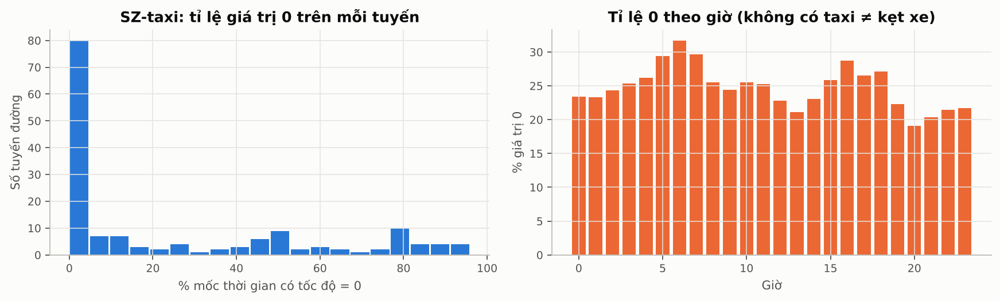


## 3. Phương pháp

### 3.1 Các mô hình

Ký hiệu: x_t ∈ R^N là tốc độ (đã chuẩn hóa z-score theo từng cảm biến, thống kê **chỉ lấy từ train**) tại bước t; A là ma trận kề; Â = D̃^(-1/2)(A + I)D̃^(-1/2) là ma trận kề chuẩn hóa đối xứng (đúng như mã tác giả: A + I với A gốc — Los-loop đã có đường chéo 1 nên self-loop thực tế là 2; SZ-taxi có hướng được giữ nguyên hướng, Â = D^(-1/2)(A+I)ᵀD^(-1/2)).

| Mô hình | Mô tả | Thông tin dùng |
|---|---|---|
| Naive (persistence) | ŷ_{t+k} = x_t | chỉ giá trị cuối |
| HA (trung bình cửa sổ) | ŷ_{t+k} = trung bình L bước vào — đúng như "HA" của tác giả (giống nhau ở mọi tầm) | thời gian |
| HA theo giờ | trung bình cùng khung giờ trên các ngày train | lịch |
| Hồi quy tuyến tính | ridge trên L độ trễ, dùng chung cho mọi nút (tương đương SVR tuyến tính của bài báo) | thời gian (tuyến tính) |
| GCN | 2 lớp GCN, L độ trễ là đặc trưng của nút, không có trạng thái hồi quy | không gian |
| GRU | một GRU dùng chung trọng số cho mọi nút, không trao đổi giữa các nút | thời gian |
| **T-GCN** | GRU mà mọi phép tuyến tính trong cổng được thay bằng GCN (công thức dưới) | không gian + thời gian |

Ô T-GCN (cùng cấu trúc với mã TensorFlow của tác giả: một lớp GCN trong mỗi cổng, bias cổng khởi tạo 1.0):

```
u_t = σ( Â [x_t , h_{t-1}] W_u + b_u )          cổng cập nhật (giữ bộ nhớ bao nhiêu)
r_t = σ( Â [x_t , h_{t-1}] W_r + b_r )          cổng reset
c_t = tanh( Â [x_t , r_t ⊙ h_{t-1}] W_c + b_c )  trạng thái ứng viên
h_t = u_t ⊙ h_{t-1} + (1 − u_t) ⊙ c_t
ŷ_{t+1..t+H} = h_L W_out + b_out                 (một đầu ra tuyến tính cho H bước, dự báo trực tiếp)
```

GRU baseline chính là ô trên với  = I. Vì vậy so sánh GRU ↔ T-GCN cô lập đúng một yếu tố: **có hay không trộn thông tin láng giềng**.

### 3.2 Các cải tiến được thử (giai đoạn 3)

| Ký hiệu | Thay đổi | Lý do (giả thuyết) |
|---|---|---|
| `+time` | nối sin/cos(giờ trong ngày), sin/cos(thứ trong tuần) vào đầu vào mỗi nút | giờ cao điểm lặp lại hằng ngày; GRU 12 bước không "biết" bây giờ là mấy giờ |
| `+res` (residual) | ŷ_{t+k} = x_t + Δ̂_k: mạng chỉ học **phần thay đổi** so với giá trị cuối | persistence đã rất mạnh ở tầm ngắn; Â làm loãng tín hiệu của chính nút (mục 5.3) |
| **T-GCN-RT** | T-GCN + time + res | kết hợp hai ý trên |
| `selfsep` | GCN dạng [x, Âx]W: trọng số riêng cho bản thân và láng giềng | giữ 100% tín hiệu của chính nút (như số hạng k = 0 của DCRNN) |
| T-GCN+ | RT + đồ thị thích nghi học từ embedding nút | bắt quan hệ không có trong đồ thị vật lý |
| Huber | hàm mất mát Smooth-L1 thay MSE | bền với ngoại lai, nhắm MAE |
| cửa sổ L, hidden | L ∈ {6, 12, 24}, hidden ∈ {32, 64, 100} | theo yêu cầu đề tài |
| Ensemble | trung bình dự báo của 3 seed | giảm phương sai, tăng độ tin cậy |

### 3.3 Thiết kế thực nghiệm (giao thức "nghiêm ngặt")

- **Chia theo thời gian 70/10/20** (train/validation/test), không xáo trộn; chuẩn hóa bằng thống kê của train; ngữ cảnh đầu vào của mẫu test được phép lấy từ quá khứ (val), nhưng **mục tiêu** luôn nằm trong 20% cuối.
- Đầu vào L = 12 bước (Los-loop: 60 phút; SZ-taxi: 3 giờ); dự báo trực tiếp H = 12 bước (Los-loop, 5…60 phút) hoặc H = 4 (SZ-taxi, 15…60 phút). Một mô hình cho mọi tầm.
- Huấn luyện: AdamW, lr 2·10⁻³ giảm dần kiểu cosine đến 10⁻⁴, weight decay 10⁻⁴, batch 32, tối đa 120 epoch, **dừng sớm theo MSE trên validation** (patience 20), cắt gradient 5. Hàm mất mát MSE cho mọi mô hình (Huber chỉ là biến thể).
- **3 seed** (42, 123, 2026) cho các mô hình chính và T-GCN-RT; báo cáo trung bình ± độ lệch chuẩn. Biến thể phụ và tinh chỉnh: 1 seed (42).
- Đánh giá: RMSE, MAE, MAPE (chỉ |y| ≥ 5), WAPE và ba chỉ số của bài báo (Accuracy, R², Var). Sai số được tính **tại đúng bước k** ("per-step"); để so với bài báo, chúng tôi tính thêm kiểu của tác giả: gộp mọi bước 1..k ("cumulative").
- Để đo độ lạc quan của giao thức tác giả, mỗi run ghi lại RMSE test ở mọi epoch (**chỉ ghi, không dùng để chọn**).
- Phần cứng: CPU 4 nhân, không GPU (≈ 15–25 giây/epoch cho T-GCN, 4 run song song).


## 4. Phản biện bài báo

Các điểm dưới đây được kiểm chứng trực tiếp từ Bảng 1 của bài báo và mã nguồn chính thức (`lehaifeng/T-GCN/T-GCN/T-GCN-TensorFlow/main.py`, `input_data.py`), không phải suy đoán.

**P1. Chọn epoch theo tập test.** Mã của tác giả đánh giá tập test sau *mỗi* epoch và báo cáo kết quả ở epoch có RMSE test nhỏ nhất:
```python
index = test_rmse.index(np.min(test_rmse))      # main.py, dòng cuối
print('min_rmse:%r' % (np.min(test_rmse)), 'min_mae:%r' % (test_mae[index]), ...)
```
Không có tập validation. Đây là rò rỉ thông tin từ test vào lựa chọn mô hình: con số báo cáo là *cận dưới lạc quan*, không phải sai số kỳ vọng trên dữ liệu mới. Chúng tôi đo trực tiếp độ lạc quan này ở mục 4.1.

**P2. Chuẩn hóa bằng giá trị lớn nhất của toàn bộ chuỗi** (`max_value = np.max(data1)` trước khi chia train/test) — một thống kê của tập test được dùng khi huấn luyện. Ảnh hưởng nhỏ (Los-loop max = 70 ở cả train lẫn test) nhưng sai về nguyên tắc.

**P3. Cách gộp sai số theo tầm dự báo.** Mã tác giả làm phẳng mọi bước đầu ra (`reshape(test_output, [-1, num_nodes])`) trước khi tính chỉ số, nên "15 phút" trên Los-loop thực chất là **trung bình của 5, 10 và 15 phút**, "60 phút" là trung bình của 12 bước. Con số vì thế dễ hơn sai số thật tại đúng thời điểm 60 phút: với GRU của chúng tôi, RMSE tại đúng bước 60 phút là 9.32 nhưng kiểu gộp của bài báo chỉ 7.50 (thấp hơn 20%).

**P4. Thiếu baseline persistence.** Baseline "giữ nguyên giá trị cuối" (ŷ_{t+k} = x_t) không cần học gì, là thước đo tối thiểu trong dự báo giao thông. Trên Los-loop, dùng **đúng cửa sổ test và cách gộp của tác giả** (80/20, cửa sổ nằm trọn trong 20% cuối), persistence đạt **MAE 3.16 ở "15 phút" — tốt hơn MAE 3.18 của T-GCN** trong bài báo; ở "60 phút" persistence có MAE 4.43 so với 4.60 của T-GCN (RMSE thì T-GCN tốt hơn: 5.13 so với 5.54 và 7.27 so với 8.46). Bài báo kết luận T-GCN vượt HA, ARIMA, SVR nhưng không cho thấy nó vượt được mức tối thiểu này theo MAE.

**P5. Kết luận không khớp với chính bảng số liệu.** Bài báo viết: *"the T-GCN model obtains the best prediction performance under all evaluation metrics for all prediction horizons"*. Nhưng trong Bảng 1, **MAE của GRU thấp hơn T-GCN ở cả 8 ô** (Los-loop: 3.06 < 3.18; 3.65 < 3.75; 4.09 < 4.12; 4.52 < 4.60 — SZ-taxi: 2.68 < 2.71; 2.70 < 2.75; 2.72 < 2.77; 2.74 < 2.79). T-GCN chỉ tốt hơn theo RMSE. Mục 5.3 giải thích cơ chế dẫn đến hiện tượng này.

**P6. "Không nhạy với tầm dự báo" là tính chất của dữ liệu, không phải của mô hình.** Trên SZ-taxi, RMSE của T-GCN chỉ tăng từ 3.92 (15 phút) lên 4.01 (60 phút). Nhưng chính trung bình trượt 3 giờ (HA cửa sổ) cũng gần như phẳng (4.16 → 4.31 trong thực nghiệm của chúng tôi): chuỗi SZ-taxi nhiễu và gần như dừng ở độ phân giải 15 phút, nên tầm dự báo ít quan trọng với *mọi* mô hình.

**P6b. Baseline HA trên SZ-taxi yếu bất thường.** Trên đúng các cửa sổ test của tác giả, trung bình 12 bước đầu vào (định nghĩa HA mà con số Los-loop của bài báo khớp: 7.48 / 3.97 so với 7.44 / 4.01) cho SZ-taxi **RMSE 4.17 / MAE 2.74**, trong khi bài báo ghi HA = 7.92 / 5.50. Với baseline đúng, khoảng cách "T-GCN tốt hơn HA 50.6%" biến mất: MAE của T-GCN (2.71) chỉ hơn trung bình trượt 3 giờ khoảng 1%, MAE của GRU (2.68) khoảng 2%.

**P7. Một lần chạy, không có độ biến thiên.** Bảng 1 không có độ lệch chuẩn hay kiểm định. Khi chênh lệch giữa GRU và T-GCN chỉ khoảng 1–3%, không thể biết nó có vượt nhiễu do khởi tạo ngẫu nhiên hay không (mục 8).

**P8. Dữ liệu.** Los-loop chỉ dài 7 ngày và chứa đoạn nội suy (gồm một lần mất dữ liệu toàn mạng); SZ-taxi có 24.8% giá trị 0 vốn là thiếu quan sát nhưng vẫn được dùng làm mục tiêu (mục 2.3).

### 4.1 Đo trực tiếp độ lạc quan của việc chọn epoch theo test

Mỗi run của chúng tôi ghi lại RMSE test ở *mọi* epoch (chỉ ghi, không dùng để chọn). So sánh RMSE test tại epoch có validation tốt nhất (cách đúng) với RMSE test nhỏ nhất qua mọi epoch (cách của tác giả):

| Mô hình | run | RMSE test – chọn theo val | RMSE test – chọn theo test | độ lạc quan TB | tối đa | epoch (val / test) |
|---|---|---|---|---|---|---|
| T-GCN + thời gian | 1 | 7.229 | 7.229 | 0.00% | 0.00% | 25 / 25 |
| GCN | 3 | 8.606 | 8.579 | 0.32% | 0.37% | 105 / 73 |
| GRU | 3 | 7.495 | 7.466 | 0.38% | 0.41% | 94 / 74 |
| T-GCN | 3 | 7.516 | 7.476 | 0.54% | 0.77% | 80 / 57 |
| T-GCN (self-loop = 1) | 1 | 7.932 | 7.889 | 0.54% | 0.54% | 85 / 59 |
| gwnet_res | 3 | 6.589 | 6.550 | 0.59% | 1.53% | 14 / 12 |
| tgcn_rtsp | 3 | 6.685 | 6.643 | 0.63% | 1.01% | 8 / 9 |
| GRU-RT (GRU + residual + thời gian) | 3 | 6.981 | 6.936 | 0.64% | 1.72% | 30 / 20 |
| T-GCN + residual | 1 | 7.475 | 7.422 | 0.71% | 0.71% | 65 / 35 |
| T-GCN-RT (residual + thời gian) | 3 | 7.375 | 7.319 | 0.76% | 1.22% | 31 / 36 |
| T-GCN-RT bỏ đồ thị (Â = I) | 1 | 7.090 | 7.028 | 0.86% | 0.86% | 23 / 9 |
| T-GCN tách self/láng giềng | 3 | 7.295 | 7.188 | 1.46% | 2.44% | 47 / 28 |
| T-GCN-RT, loss đơn vị gốc | 1 | 7.398 | 7.280 | 1.60% | 1.60% | 18 / 38 |
| T-GCN+ (RT + đồ thị thích nghi) | 1 | 7.369 | 7.226 | 1.93% | 1.93% | 44 / 38 |
| T-GCN-RT + Huber | 1 | 7.390 | 7.240 | 2.03% | 2.03% | 41 / 29 |
| gru_rtp | 3 | 6.829 | 6.683 | 2.13% | 2.65% | 9 / 16 |
| GRU-RT, loss đơn vị gốc | 3 | 7.143 | 6.983 | 2.18% | 5.56% | 34 / 24 |
| stid_res | 3 | 7.477 | 7.285 | 2.54% | 5.32% | 8 / 4 |
| gwnet | 1 | 6.860 | 6.678 | 2.66% | 2.66% | 10 / 12 |
| stid | 3 | 7.427 | 7.208 | 2.92% | 5.13% | 7 / 4 |
| T-GCN-RT tách self/láng giềng (T-GCN-RTS) | 3 | 7.219 | 6.974 | 3.39% | 3.91% | 22 / 9 |
| dcrnn_res | 1 | 7.560 | 7.037 | 6.92% | 6.92% | 25 / 5 |
| dcrnn | 1 | 7.863 | 6.942 | 11.71% | 11.71% | 27 / 6 |

Chọn theo test làm sai số đẹp hơn trung bình 1.60% (tối đa 11.71%) trên toàn bộ các run. Độ lạc quan **tăng theo mức dễ quá khớp**: 0.3–0.5% với GCN/GRU/T-GCN (đường học mượt), nhưng 2–5.6% với các mô hình nhiều tham số hoặc dừng sớm (tách self + RT, loss đơn vị gốc, Huber, đồ thị thích nghi) — đường sai số test của chúng dao động mạnh nên "chọn đỉnh đẹp nhất" được lợi nhiều hơn. Con số nghe nhỏ, nhưng **cùng cỡ với toàn bộ lợi thế mà bài báo báo cáo cho T-GCN so với GRU** trên Los-loop (RMSE "15 phút" 5.13 so với 5.22, tức 1.8%). Mục 9.2 tái lập nguyên vẹn giao thức của tác giả để so sánh trực tiếp.


## 5. Kết quả thực nghiệm trên Los-loop

Mọi con số dưới đây là trên **tập test** (20% cuối, 06/03 14:20 → 07/03 23:55), sai số tại đúng bước k (per-step) trừ khi ghi "kiểu bài báo"; "TB 12 tầm" là sai số gộp mọi bước 5…60 phút. Mô hình có 3 seed được ghi trung bình ± độ lệch chuẩn.

### 5.1 Giai đoạn 1 — GRU: kết quả ban đầu

GRU (hidden 64, L = 12) hội tụ ổn định (dừng sớm ở epoch 87–101) và **rất ít phụ thuộc seed**: RMSE TB 12 tầm = 7.495 ± 0.006, MAE = 4.175 ± 0.023. Tính theo đúng cách của bài báo, GRU của chúng tôi đạt RMSE 5.217 / MAE 2.965 ở "15 phút" và 7.495 / 4.175 ở "60 phút" — **khớp sát** GRU trong Bảng 1 của bài báo (5.218 / 3.060 và 7.662 / 4.519; RMSE "15 phút" gần như trùng), dù chúng tôi train trên ít dữ liệu hơn (70% so với 80%) và chọn epoch bằng validation. Kết luận giai đoạn 1: pipeline dữ liệu, chuẩn hóa và đánh giá là đúng; GRU là baseline đáng tin cậy và **vượt persistence ở mọi tầm** (skill +9% ở 5 phút, +26% ở 60 phút).

### 5.2 Giai đoạn 2 — T-GCN trên cùng dữ liệu, cùng cách chia

| Mô hình | seed | RMSE TB 12 tầm | MAE TB 12 tầm | 5 phút | 15 phút | 30 phút | 60 phút |
|---|---|---|---|---|---|---|---|
| Persistence (giữ giá trị cuối) | 1 | 8.418 | 4.408 | **4.45** / **2.69** | 6.45 / **3.56** | 8.22 / 4.37 | 10.85 / 5.77 |
| GCN | 3 | 8.606 ± 0.009 | 5.345 ± 0.009 | 7.42 / 4.60 | 7.85 / 4.89 | 8.48 / 5.30 | 9.69 / 6.04 |
| GRU | 3 | **7.495** ± 0.006 | **4.175** ± 0.023 | **4.24** / **2.53** | **6.00** / **3.36** | **7.44** / **4.18** | 9.32 / **5.38** |
| T-GCN gốc — *baseline* | 3 | 7.516 ± 0.031 | 4.371 ± 0.037 | 4.86 / 3.04 | 6.16 / 3.67 | 7.47 / 4.36 | 9.13 / 5.39 |

*(ô "5 phút … 60 phút" = RMSE / MAE tại đúng bước đó)*

*Số in đậm = tốt hơn T-GCN gốc (dòng baseline) ở cùng cột, so ở đúng số chữ số hiển thị; sai số thấp hơn là tốt hơn.*

Ba quan sát:

1. **T-GCN không tốt hơn GRU tổng thể.** Chênh lệch RMSE +0.02 (KTC 95% bootstrap khối [−0.12; +0.15], kiểm định Diebold–Mariano p = 0.76) — không có ý nghĩa thống kê; MAE thì GRU tốt hơn rõ (4.18 so với 4.37). Điều này **trùng khớp với Bảng 1 của chính bài báo**, nơi MAE của GRU thấp hơn T-GCN ở cả 8 ô (mục 4, P5).
2. **Có điểm giao nhau theo tầm dự báo:** ở tầm ngắn T-GCN kém GRU rõ (5 phút: 4.86 so với 4.24 — kém cả persistence 4.45; trong bảng, persistence được in đậm ở 5 phút vì tốt hơn T-GCN), nhưng ở 45–60 phút T-GCN tốt hơn (60 phút: 9.13 so với 9.32). Thông tin láng giềng có ích để dự báo xa (ùn tắc lan truyền) nhưng làm hại dự báo gần — mục 7.3 giải thích cơ chế.
3. **Cách chuẩn hóa đồ thị quyết định T-GCN tốt hay tệ.** Phiên bản đầu của dự án đặt đường chéo  = 1 (không cộng thêm I như mã tác giả) cho T-GCN RMSE 7.93 / MAE 4.74 (5 phút: 5.96!). Chỉ riêng việc tăng trọng số tự thân (self-loop = 2, đúng như mã gốc) đã đưa T-GCN về 7.52 / 4.37. Đây là bằng chứng trực tiếp đầu tiên cho giả thuyết "loãng tín hiệu của chính nút".

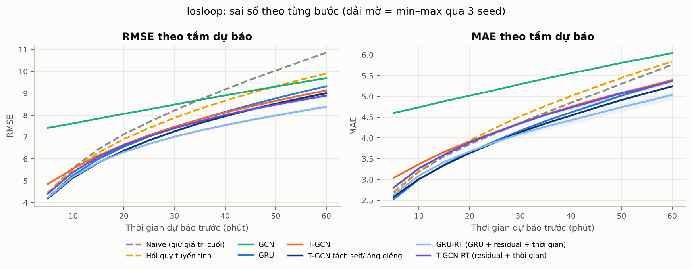

### 5.3 Giai đoạn 3 — So sánh sai số và phân tích giờ cao điểm

**Sai số tập trung vào giờ cao điểm.** Giờ cao điểm ngày thường (7–9h, 16–19h) chiếm 24% mục tiêu của tập test nhưng MAE ở đó cao gấp 1.4–2 lần ngoài cao điểm (Hình 8). Bảng dưới tách tập test theo trạng thái giao thông (MAE, trung bình 3 seed):

**MAE – dự báo trước 15 phút**

| Mô hình | tất cả | ngoài cao điểm | cao điểm | thông thoáng | kẹt xe (v<40) | biến động mạnh (Δ>10) |
|---|---|---|---|---|---|---|
| Naive (giữ giá trị cuối) | **3.562** | 3.355 | **4.203** | 3.048 | **6.950** | 18.621 |
| Hồi quy tuyến tính | **3.607** | 3.180 | **4.931** | **2.782** | 9.050 | 16.172 |
| GRU | **3.359** | **3.004** | **4.456** | **2.635** | **8.135** | 15.554 |
| GCN | 4.886 | 3.885 | 7.984 | 3.788 | 12.130 | **13.339** |
| T-GCN gốc — *baseline* | 3.669 | 3.161 | 5.242 | 2.890 | 8.807 | 14.126 |
| T-GCN tách self/láng giềng | **3.342** | **2.965** | **4.507** | **2.669** | **7.781** | 14.638 |
| GRU-RT (GRU + residual + thời gian) | **3.427** | **3.062** | **4.556** | **2.788** | **7.646** | 14.524 |
| T-GCN-RT (residual + thời gian) | **3.602** | 3.224 | **4.771** | 2.894 | **8.274** | 15.071 |

**MAE – dự báo trước 60 phút**

| Mô hình | tất cả | ngoài cao điểm | cao điểm | thông thoáng | kẹt xe (v<40) | biến động mạnh (Δ>10) |
|---|---|---|---|---|---|---|
| Naive (giữ giá trị cuối) | 5.765 | 5.223 | **7.441** | 4.592 | **13.580** | 24.286 |
| Hồi quy tuyến tính | 5.842 | 4.727 | 9.289 | 3.919 | 18.652 | 19.079 |
| GRU | **5.379** | 4.358 | **8.537** | **3.641** | 16.959 | 17.578 |
| GCN | 6.042 | 4.831 | 9.788 | 4.284 | 17.752 | **16.179** |
| T-GCN gốc — *baseline* | 5.394 | 4.354 | 8.612 | 3.766 | 16.238 | 16.538 |
| T-GCN tách self/láng giềng | **5.232** | **4.272** | **8.200** | **3.715** | **15.335** | 16.691 |
| GRU-RT (GRU + residual + thời gian) | **5.038** | **4.057** | **8.074** | 3.782 | **13.406** | **14.978** |
| T-GCN-RT (residual + thời gian) | **5.370** | 4.443 | **8.239** | 4.042 | **14.219** | **15.852** |

*Tỉ lệ mẫu test: ngoài cao điểm 76%, cao điểm 24%, thông thoáng 87%, kẹt xe (v<40) 13%, biến động mạnh (Δ>10) 7%.*

*Số in đậm = tốt hơn T-GCN gốc (dòng baseline) ở cùng cột, so ở đúng số chữ số hiển thị; sai số thấp hơn là tốt hơn.*

Những điều bảng này cho thấy — và bài báo không phân tích:

- **Trong giờ cao điểm, persistence có MAE thấp nhất ở cả 15 lẫn 60 phút; khi kẹt xe (v < 40 mph) nó cũng tốt nhất ở 15 phút**, và ở 60 phút chỉ GRU-RT nhỉnh hơn nó (13.4 so với 13.6). Mô hình học sâu thắng tổng thể chủ yếu nhờ 76% thời gian ngoài cao điểm, nơi chúng làm trơn tốt dao động nhỏ.
- **Khi tốc độ biến động mạnh (|Δ| > 10 mph so với giá trị cuối, 7% mẫu), các mô hình có đồ thị tốt nhất ở 15 phút** (GCN 13.3, T-GCN 14.1 so với GRU 15.6 và persistence 18.6): láng giềng phía trước "báo trước" cú sốc. Đây là nơi duy nhất đồ thị tạo khác biệt rõ ở tầm ngắn; ở 60 phút, GRU-RT lại tốt nhất (15.0).
- Mọi mô hình học sâu **dự báo lạc quan khi kẹt xe**: với tốc độ thực ≤ 20 mph, sai số trung bình (bias) là +9 mph (Hình 18) — hệ quả của hàm mất mát MSE (dự báo kỳ vọng có điều kiện, kéo về mức thông thoáng chiếm đa số).

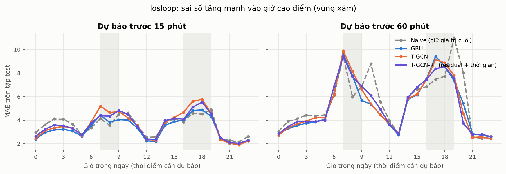

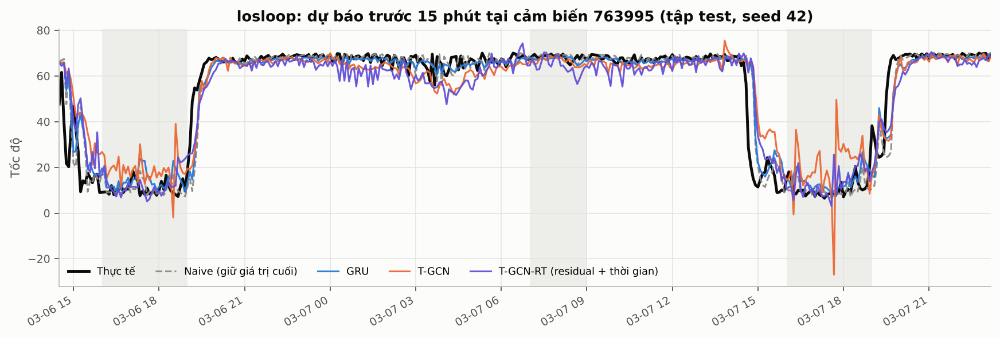

Hình 9 cho thấy thêm: mọi mô hình đều "trễ" khoảng một tầm dự báo khi kẹt xe bắt đầu (không thể biết trước một sự kiện chưa có dấu hiệu trong 60 phút đầu vào), và T-GCN gốc cho cả dự báo **phi vật lý** (tốc độ âm tới −27 mph) vì đầu ra tuyến tính không bị chặn.

### 5.4 Giai đoạn 3 — Thử cải thiện: cửa sổ đầu vào, hidden units, đặc trưng thời gian, residual

Theo yêu cầu đề tài, chúng tôi thử ba "núm vặn" trên T-GCN: độ dài cửa sổ đầu vào, số hidden units và đặc trưng thời gian; sau đó thử thêm các thay đổi về *cách đặt bài toán* (residual, hàm mất mát) và về *cách dùng đồ thị*. Tinh chỉnh dùng seed 42 (so với cấu hình mặc định cùng seed).

**Cửa sổ đầu vào và số hidden units:**

| Cấu hình (seed 42) | tham số | RMSE TB | MAE TB | 15 phút | 60 phút | epoch chọn | thời gian train (phút) |
|---|---|---|---|---|---|---|---|
| T-GCN, L = 12, hidden = 64 (mặc định) — *baseline* | 13,452 | 7.482 | 4.336 | 6.15 / 3.65 | 9.07 / 5.35 | 65 | 20 |
| T-GCN, L = 6 (30 phút) | 13,452 | 7.578 | 4.451 | **6.14** / 3.68 | 9.29 / 5.56 | 105 | 25 |
| T-GCN, L = 24 (120 phút) | 13,452 | 7.483 | 4.404 | 6.17 / 3.72 | **9.02** / 5.38 | 47 | 35 |
| T-GCN, hidden = 32 | 3,660 | **7.466** | 4.370 | **6.14** / 3.67 | 9.08 / 5.38 | 117 | 15 |
| T-GCN, hidden = 100 | 31,812 | 7.533 | 4.431 | 6.16 / 3.68 | 9.17 / 5.53 | 56 | 35 |
| T-GCN-RT, L = 12 | 14,220 | **7.350** | **4.324** | **6.13** / **3.61** | **8.83** / 5.35 | 33 | 13 |
| T-GCN-RT, L = 6 | 14,220 | **7.272** | 4.382 | **6.03** / **3.63** | **8.80** / 5.48 | 55 | 10 |
| T-GCN-RT, L = 24 | 14,220 | 7.526 | 4.384 | 6.15 / **3.62** | 9.12 / 5.44 | 35 | 27 |

*Số in đậm = tốt hơn T-GCN gốc mặc định cùng seed 42 (dòng baseline) ở cùng cột, so ở đúng số chữ số hiển thị; sai số thấp hơn là tốt hơn.*

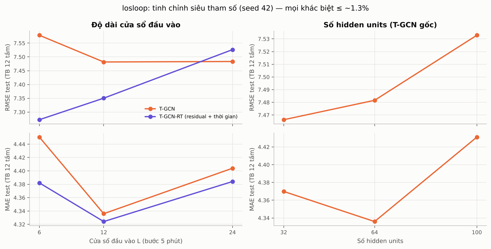

- **Cửa sổ L:** với T-GCN gốc, L = 6 (30 phút) kém hơn L = 12 (RMSE 7.58 so với 7.48, chủ yếu ở 60 phút: 9.29 so với 9.07) — nửa giờ lịch sử không đủ thấy xu hướng. L = 24 (2 giờ) không cải thiện mà tăng gấp đôi thời gian huấn luyện; với T-GCN-RT còn kém hơn (7.53 so với 7.35) vì thông tin > 1 giờ trước gần như không liên quan (tự tương quan ở 120 phút chỉ 0.29) mà làm mô hình dễ quá khớp. MAE nhỏ nhất ở L = 12 cho cả hai mô hình.
- **Hidden units:** 32 ≈ 64 (7.47 so với 7.48) với ¼ số tham số (3 660 so với 13 452); 100 kém hơn một chút (7.53 / 4.43) và quá khớp sớm hơn. Khớp nhận xét của bài báo (sai số giảm rồi tăng theo số hidden), nhưng biên độ chỉ ~1%.
- **Đặc trưng thời gian:** xem bảng ablation dưới (RMSE −3.4% nhưng MAE +3.1% nếu thêm riêng lẻ).

⇒ **Siêu tham số không phải đòn bẩy chính**: trong khoảng thử, mọi thay đổi ≤ 1.3% — nhỏ hơn nhiều tác động của residual + thời gian (−6% với GRU). Lựa chọn L = 12, hidden = 64 của bài báo là hợp lý.

**Từng thành phần một (cùng seed 42, so với T-GCN gốc):**

| Cấu hình (seed 42) | RMSE TB | MAE TB | 15 phút | 60 phút | ΔRMSE vs T-GCN | ΔMAE vs T-GCN | epoch chọn |
|---|---|---|---|---|---|---|---|
| GRU (không đồ thị) | 7.488 | **4.169** | **5.99** / **3.35** | 9.31 / 5.38 | +0.1% | -3.9% | 101 |
| T-GCN (gốc) — *baseline* | 7.482 | 4.336 | 6.15 / 3.65 | 9.07 / 5.35 | — | — | 65 |
| T-GCN, self-loop = 1 (bản cài đặt đầu) | 7.932 | 4.740 | 6.82 / 4.16 | 9.29 / 5.58 | +6.0% | +9.3% | 85 |
| + thời gian | **7.229** | 4.472 | 6.21 / 3.86 | **8.53** / **5.33** | -3.4% | +3.1% | 25 |
| + residual | **7.475** | **4.307** | **6.02** / **3.55** | 9.23 / 5.44 | -0.1% | -0.7% | 65 |
| + tách self/láng giềng | **7.364** | **4.145** | **5.88** / **3.36** | 9.07 / **5.27** | -1.6% | -4.4% | 64 |
| + residual + thời gian (T-GCN-RT) | **7.350** | **4.324** | **6.13** / **3.61** | **8.83** / 5.35 | -1.8% | -0.3% | 33 |
| T-GCN-RT bỏ đồ thị (Â = I) | **7.090** | **4.192** | **5.87** / **3.47** | **8.58** / **5.25** | -5.2% | -3.3% | 23 |
| GRU + residual + thời gian | **7.045** | **4.080** | **5.88** / **3.44** | **8.49** / **5.09** | -5.8% | -5.9% | 33 |
| T-GCN-RT + tách self/láng giềng | **7.172** | **4.127** | **5.89** / **3.47** | **8.72** / **5.12** | -4.1% | -4.8% | 18 |
| T-GCN-RT + đồ thị thích nghi (T-GCN+) | **7.369** | **4.308** | **6.07** / **3.63** | **8.88** / **5.31** | -1.5% | -0.6% | 44 |
| T-GCN-RT + Huber loss | **7.390** | **4.141** | **6.07** / **3.50** | **8.99** / **5.06** | -1.2% | -4.5% | 41 |
| T-GCN-RT + loss đơn vị gốc | **7.398** | 4.338 | **6.11** / **3.56** | **8.94** / 5.47 | -1.1% | +0.0% | 18 |
| GRU-RT + loss đơn vị gốc | **6.938** | **4.032** | **5.78** / **3.37** | **8.36** / **5.01** | -7.3% | -7.0% | 35 |

*Số in đậm = tốt hơn T-GCN gốc cùng seed 42 (dòng baseline) ở cùng cột, so ở đúng số chữ số hiển thị; sai số thấp hơn là tốt hơn.*

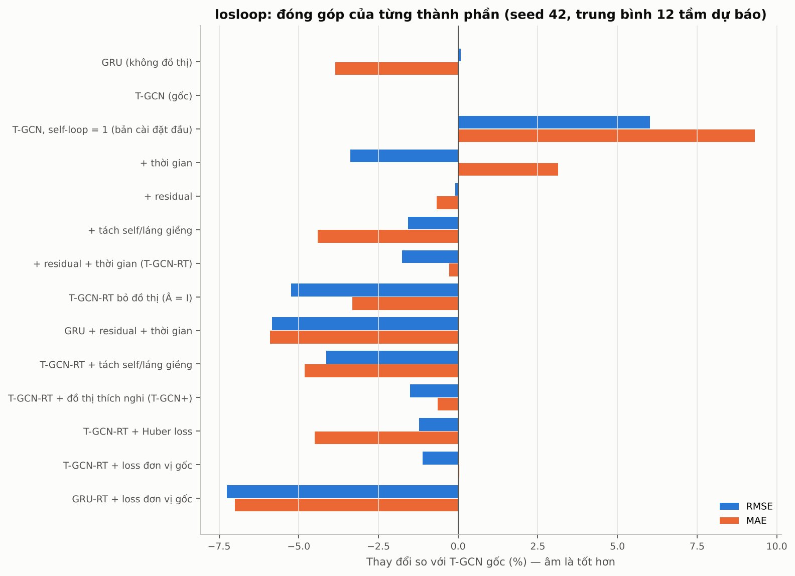

Đọc bảng ablation theo cặp có kiểm soát:

- **Residual sửa tầm ngắn, đặc trưng thời gian sửa tầm dài.** T-GCN + residual (seed 42): 5 phút 4.84 → 4.33 nhưng 60 phút gần như không đổi; T-GCN + thời gian: 60 phút 9.07 → 8.53 nhưng 5 phút xấu đi. Kết hợp (T-GCN-RT) lấy được cả hai.
- **Cùng ô T-GCN-RT nhưng bỏ đồ thị (Â = I) lại tốt hơn có đồ thị** (7.09 so với 7.35). Với cách chuẩn hóa của tác giả, đồ thị vật lý gây hại khi mô hình đã có residual + thời gian.
- **Tách self/láng giềng ([x, Âx]W) là cách duy nhất làm đồ thị có lợi:** T-GCN tách self (không RT) đạt **7.30 ± 0.06 / 4.12 ± 0.02 qua 3 seed — tốt hơn GRU có ý nghĩa thống kê** (ΔRMSE −0.20, KTC 95% [−0.34; −0.07], DM p = 0.010) và tốt hơn T-GCN gốc (p < 0.001); T-GCN-RT tách self đạt 7.17 / 4.13 so với 7.35 / 4.32 của T-GCN-RT.
- **Loss theo đơn vị gốc** (nhân trọng số std² cho mỗi cảm biến, để cảm biến hay kẹt được coi trọng như khi chấm điểm) cải thiện GRU-RT ở seed 42 (6.94 / 4.03 so với 7.05 / 4.08) — nhưng **không lặp lại qua 3 seed** (7.14 ± 0.24 so với 6.98 ± 0.06) và không giúp T-GCN-RT. Đây là ví dụ cụ thể vì sao không được kết luận từ một lần chạy (đúng lỗi P7 của bài báo).
- **Huber** đổi RMSE lấy MAE (MAE 4.32 → 4.14, RMSE 7.35 → 7.39) — đúng như lý thuyết (Huber nhắm trung vị nhiều hơn kỳ vọng).
- **Đồ thị thích nghi (T-GCN+)** không mang lại gì (7.37 so với 7.35): 207 × 8 tham số embedding không học được quan hệ mới từ 5 ngày dữ liệu.

### 5.5 Mô hình cuối cùng — chọn bằng validation, không bằng test

Để không lặp lại lỗi chọn-theo-test của bài báo, cấu hình cuối được chọn theo **RMSE validation** (đơn vị gốc, so sánh được giữa các hàm mất mát), sau đó mới xem test:

| Cấu hình (3 seed) | RMSE validation ↓ (tiêu chí chọn) | RMSE test | MAE test |
|---|---|---|---|
| GRU | **6.194** ± 0.003 | **7.495** ± 0.006 | **4.175** ± 0.023 |
| T-GCN gốc — *baseline* | 6.284 ± 0.027 | 7.516 ± 0.031 | 4.371 ± 0.037 |
| T-GCN tách self/láng giềng | **6.091** ± 0.039 | **7.295** ± 0.060 | **4.124** ± 0.019 |
| GRU-RT (GRU + residual + thời gian) | **5.906** ± 0.056 | **6.981** ± 0.063 | **4.065** ± 0.063 |
| T-GCN-RT (residual + thời gian) | **6.158** ± 0.004 | **7.375** ± 0.043 | **4.325** ± 0.029 |
| T-GCN-RT tách self/láng giềng (T-GCN-RTS) | **5.937** ± 0.110 | **7.219** ± 0.054 | **4.156** ± 0.052 |
| GRU-RT, loss đơn vị gốc | **5.915** ± 0.092 | **7.143** ± 0.244 | **4.087** ± 0.068 |
| Ensemble GRU-RT (3 seed) | — | **6.911** | **4.012** |
| Ensemble T-GCN tách self (3 seed) | — | **7.190** | **4.065** |
| Ensemble GRU-RT + T-GCN-RTS | — | **6.928** | **4.001** |

*Số in đậm = tốt hơn T-GCN gốc (dòng baseline) ở cùng cột, so ở đúng số chữ số hiển thị; sai số thấp hơn là tốt hơn.*

- **Theo validation, GRU-RT là cấu hình tốt nhất** (RMSE val 5.906 ± 0.056); thứ hạng trên test giống hệt thứ hạng trên validation, nên lựa chọn này không "nhìn trộm" test. **Mô hình cuối cùng = ensemble 3 seed của GRU-RT**: test RMSE 6.91 / MAE 4.01 TB 12 tầm — giảm 7.8% RMSE và 3.9% MAE so với GRU, 8.0% / 8.2% so với T-GCN gốc (Bảng 9.1: tốt hơn mọi con số của bài báo).
- **Mô hình đồ thị tốt nhất là T-GCN tách self/láng giềng**: không residual, không đặc trưng giờ mà vẫn vượt GRU có ý nghĩa (7.30 so với 7.50, p = 0.01). Đây là câu trả lời cho câu hỏi "đồ thị có giúp không?": *có*, nếu phép tích chập không xóa mờ thông tin riêng của nút.
- Ensemble hỗn hợp GRU-RT + T-GCN-RTS có MAE thấp nhất (4.00) nhưng không khác ensemble GRU-RT có ý nghĩa (p = 0.50) mà tốn gấp đôi chi phí ⇒ không chọn.
- Hai khuyến nghị khi triển khai đi kèm mô hình cuối (mục 8): kiểm tra/điền giá trị thiếu trước khi dự báo (mô hình residual nhạy với đầu vào = 0) và cắt dự báo về miền vật lý [0, v_max] (đã cài trong `predict.py`).


## 6. Mô hình huấn luyện được là gì và cách đọc lên để dự báo

### 6.1 "Mô hình" thực chất là gì

Sau huấn luyện, mô hình là **một tệp checkpoint** (`best.pt`, 0.1–0.4 MB, phần lớn là ma trận kề 207 × 207 được lưu kèm; bản thân trọng số chỉ ≈ 60 KB) — chính là trạng thái ở epoch có MSE validation nhỏ nhất. Tệp này là một `dict` PyTorch gồm:

| Khóa | Nội dung |
|---|---|
| `state_dict` | các tensor trọng số đã học (bảng dưới) |
| `config` | toàn bộ siêu tham số của lần chạy: `model`, `seq_len`, `horizon`, `hidden_dim`, `residual`, `time_features`, `self_sep`, lr, seed... |
| `data_stats` | trung bình/độ lệch chuẩn của **train** cho từng cảm biến, ma trận  đã chuẩn hóa, danh sách mã cảm biến, bước thời gian ⇒ checkpoint **tự đủ**, không cần đọc lại dữ liệu train |
| `best_epoch`, `best_val_mse_scaled` | epoch được chọn và sai số validation tương ứng |

Thẻ mô hình của T-GCN-RT (Los-loop, hidden = 64, L = 12, H = 12):

| Tensor | Kích thước | Số phần tử | Học? | Vai trò |
|---|---|---|---|---|
| `adj` | 207x207 | 42,849 | không | Â = D^-1/2 (A+I) D^-1/2 (cố định, không học) |
| `cell.gates.linear.weight` | 128x69 | 8,832 | có | W_g: GCN trong cổng reset r và update u, [2H, 1(+4)+H] |
| `cell.gates.linear.bias` | 128 | 128 | có | b_g: bias cổng (khởi tạo 1.0 như mã tác giả) |
| `cell.candidate.linear.weight` | 64x69 | 4,416 | có | W_c: GCN tạo trạng thái ứng viên c, [H, 1(+4)+H] |
| `cell.candidate.linear.bias` | 64 | 64 | có | b_c |
| `head.weight` | 12x64 | 768 | có | W_out: ánh xạ trạng thái ẩn → H bước dự báo |
| `head.bias` | 12 | 12 | có | b_out |

Tổng số tham số học được: **14,220**.

Điểm đáng chú ý: **mọi nút dùng chung một bộ trọng số** (W_g, W_c, W_out không phụ thuộc N). Vì vậy mô hình rất nhỏ (≈ 14 nghìn tham số cho 207 cảm biến); điều làm các nút khác nhau là (i) chuỗi đầu vào của chính nút và (ii) láng giềng của nó qua Â. Hệ quả thực tế: không thể dùng checkpoint Los-loop cho SZ-taxi (khác Â, khác thống kê chuẩn hóa), nhưng có thể thêm cảm biến mới nếu biết vị trí của nó trên đồ thị.

### 6.2 Quy trình dự báo khi "đọc" mô hình lên

Thư mục `models/` chứa: `losloop_gru.pt`, `losloop_tgcn.pt`, `losloop_tgcn_selfsep.pt`, `losloop_tgcn_res_time.pt` (mô hình so sánh — seed có loss validation nhỏ nhất) và **`losloop_gru_res_time_seed{42,123,2026}.pt` — mô hình cuối cùng, dùng chung như một ensemble**. `models/index.json` ghi nguồn gốc và sai số test của từng tệp.

```
1. Đọc checkpoint         ck = torch.load('models/losloop_gru_res_time_seed42.pt')
2. Dựng lại kiến trúc     model = build_model(Namespace(**ck['config']), Â)   # từ data_stats
3. Nạp trọng số           model.load_state_dict(ck['state_dict']); model.eval()
4. Lấy 12 mốc gần nhất    X_raw: [12, 207]  (tốc độ thô, mph)
5. Chuẩn hóa              X = (X_raw − mean_train) / std_train
6. Đặc trưng thời gian    sin/cos(giờ), sin/cos(thứ) của 12 mốc đó
7. Chạy mô hình           ŷ = model(X, time) → [12, 207]   (12 bước × 207 cảm biến)
                          (residual: ŷ = x_t + Δ̂ được cộng sẵn bên trong mô hình)
8. Đổi về đơn vị gốc      Ŷ = ŷ · std_train + mean_train
9. Ensemble + hậu xử lý   trung bình Ŷ của 3 checkpoint, cắt về Ŷ ≥ 0
```

Toàn bộ quy trình được đóng gói trong `predict.py` (lớp `Forecaster`; truyền nhiều `--checkpoint` để ensemble). Ví dụ dự báo lúc 07:30 sáng thứ Tư 07/03/2012 (giờ cao điểm, nằm trong tập test) bằng mô hình cuối và đối chiếu với thực tế:

```bash
python predict.py --checkpoint models/losloop_gru_res_time_seed*.pt --input data/losloop/speed.csv --end-time "2012-03-07 07:30" --compare --sensors 4
```

```
Model gru (residual=True, time_features=True, self_sep=False) | 14412 parameters | ensemble of 3 checkpoints
Input: 12 steps ending 2012-03-07 07:30:00; forecast 12 steps x 5 min
                      forecast                                      actual                                 
                        773869     767541     767542     717447     773869     767541     767542     717447
target_time                                                                                                
2012-03-07 07:35:00  66.599998  64.900002  24.900000  51.200001  67.625000  65.750000  18.125000  51.875000
2012-03-07 07:40:00  66.199997  64.800003  26.200001  50.900002  67.444444  66.111111  20.000000  48.333333
2012-03-07 07:45:00  65.699997  64.599998  27.700001  50.500000  68.000000  67.250000  18.125000  46.500000
2012-03-07 07:50:00  65.300003  64.400002  28.900000  50.200001  68.333333  63.888889  20.000000  50.222222
2012-03-07 07:55:00  64.800003  64.300003  30.000000  49.900002  67.875000  67.750000  24.750000  50.000000
2012-03-07 08:00:00  64.300003  64.099998  31.200001  49.599998  68.777778  60.666667  26.666667  51.555556
2012-03-07 08:05:00  63.799999  64.000000  32.500000  49.400002  66.500000  65.750000  20.500000  51.875000
2012-03-07 08:10:00  63.299999  63.900002  33.700001  49.099998  68.500000  65.000000  18.375000  45.625000
2012-03-07 08:15:00  62.900002  63.799999  35.000000  48.900002  66.555556  66.222222  21.777778  51.333333
2012-03-07 08:20:00  62.400002  63.700001  36.299999  48.599998  68.000000  64.875000  21.500000  54.625000
2012-03-07 08:25:00  62.000000  63.599998  37.200001  48.500000  67.333333  66.333333  21.833333  53.500000
2012-03-07 08:30:00  61.299999  63.500000  38.500000  48.200001  67.222222  67.000000  22.555556  53.111111
```

Ba cảm biến thông thoáng (773869, 767541, 717447) được dự báo sát, sai số vài mph. Cảm biến 767542 đang kẹt (~18–20 mph): mô hình dự báo tốc độ **hồi phục dần lên ~38 mph sau 1 giờ** trong khi thực tế vẫn kẹt — đúng thiên lệch "lạc quan khi kẹt xe" đã đo ở mục 8.5. Đây là cách đọc kết quả đúng: con số dự báo là kỳ vọng có điều kiện, nên trong tình huống bất định (kẹt sẽ tan hay không) nó nằm giữa hai kịch bản.

Đầu ra có thể ghi ra CSV (`--output forecast.csv`, H dòng × N cột). Muốn dùng dữ liệu mới: chỉ cần CSV cùng thứ tự cột cảm biến và thời điểm bắt đầu (`--start-time`).


## 7. Minh chứng — giải thích kết quả từ cách mô hình hoạt động

### 7.1 Ảnh hưởng của thuộc tính lên mô hình dự báo

Chúng tôi đo **permutation importance trên tập test**: xáo trộn một nhóm đầu vào giữa các mẫu (giữ nguyên phân phối, cắt đứt liên hệ với mục tiêu) rồi xem RMSE tăng bao nhiêu. Với đầu vào không gian, phép đo làm riêng cho từng nút đích (40 nút ngẫu nhiên): xáo trộn chuỗi của chính nút / của các láng giềng 1-hop / của cùng số nút ở xa (≥ 4 hop, đối chứng).

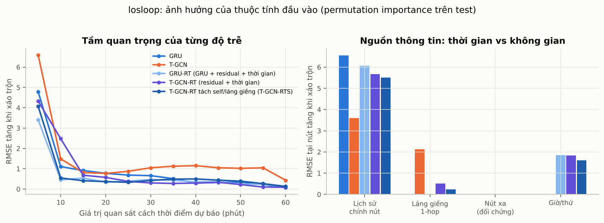

*ΔRMSE = RMSE tăng thêm khi xáo trộn nhóm đầu vào (cột không gian: RMSE tại nút đích, TB 40 nút).*

| Mô hình | RMSE gốc | lag 5 phút | lag 15 phút | lag 60 phút | lịch sử của chính nút | láng giềng 1-hop | nút ngẫu nhiên xa (≥4 hop) | đặc trưng thời gian (giờ, thứ) |
|---|---|---|---|---|---|---|---|---|
| GRU | 7.488 | 4.786 | 0.913 | 0.066 | 6.555 | 0.000 | 0.000 | — |
| T-GCN | 7.482 | 6.593 | 0.812 | 0.433 | 3.593 | 2.122 | -0.000 | — |
| GRU-RT (GRU + residual + thời gian) | 7.045 | 3.410 | 0.542 | 0.139 | 6.061 | 0.000 | 0.000 | 1.850 |
| T-GCN-RT (residual + thời gian) | 7.350 | 4.331 | 0.683 | 0.089 | 5.673 | 0.507 | -0.000 | 1.833 |
| T-GCN-RT tách self/láng giềng (T-GCN-RTS) | 7.172 | 4.070 | 0.412 | 0.130 | 5.502 | 0.237 | -0.000 | 1.606 |

Đọc kết quả:

- **Độ trễ gần nhất áp đảo.** Với mọi mô hình, xáo trộn giá trị 5 phút trước làm RMSE tăng mạnh nhất; từ 15 phút trở về trước ảnh hưởng nhỏ dần. Điều này khớp với tự tương quan (0.82 ở 5 phút) và giải thích vì sao persistence mạnh. Riêng T-GCN gốc dựa nhiều hơn vào các độ trễ xa (30–55 phút) — dấu hiệu trạng thái ẩn bị "làm trơn" theo cả không gian lẫn thời gian.
- **Lịch sử của chính nút là nguồn thông tin chính (ΔRMSE ≈ 5.5–6.6).** T-GCN gốc là ngoại lệ: chỉ 3.6 cho chính nút (các mô hình khác 5.5–6.6) và tới 2.1 cho láng giềng — một phần lớn thông tin bị chuyển từ chính nút sang láng giềng, đúng như dự đoán từ trọng số của Â.
- **Láng giềng xa có ảnh hưởng đúng bằng 0** với mọi mô hình (kiểm tra hợp lệ của phương pháp); với GRU, láng giềng 1-hop cũng bằng 0 — đúng thiết kế.
- **Đặc trưng thời gian (giờ, thứ) có ích rõ** cho các mô hình RT (ΔRMSE ≈ 1.6–1.8), chủ yếu ở tầm xa (mục 5.4).

### 7.2 Trường tiếp nhận không gian–thời gian

Gradient saliency |∂ŷ_i/∂x_j(t−ℓ)| (dự báo 15 phút) gộp theo khoảng cách đồ thị giữa i và j và theo độ trễ ℓ cho thấy mô hình *thực sự* nhìn vào đâu:

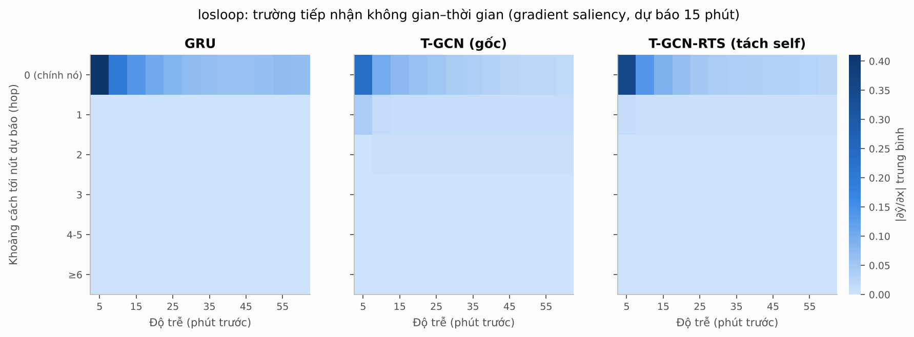

- **GRU** chỉ nhạy với chính nút (hàng 0 hop), giảm dần theo độ trễ.
- **T-GCN gốc**: độ nhạy với chính nút ở độ trễ 5 phút giảm từ ≈ 0.41 (GRU) xuống ≈ 0.27, phần còn lại chuyển sang láng giềng 1–2 hop. Vì mỗi bước GRU áp  lên cả đầu vào lẫn trạng thái ẩn, trường tiếp nhận về lý thuyết mở rộng thêm ít nhất 1 hop mỗi bước; thực tế mô hình chỉ dùng tới ~2 hop.
- **T-GCN tách self/láng giềng** khôi phục độ nhạy với chính nút (≈ 0.40) mà vẫn giữ một phần thông tin 1-hop — đúng như thiết kế.

### 7.3 Vì sao T-GCN không thắng GRU: tín hiệu của chính nút bị "loãng"

Với  = D^(-1/2)(A + I)D^(-1/2), giá trị mà nút i "thấy" ở mỗi bước là Σ_j Â_ij x_j. Trên Los-loop (bậc trung bình 12.7, cạnh có trọng số), **phần trọng số dành cho chính nút chỉ là 32% (trung vị 26%)** với chuẩn hóa của tác giả, và 20.5% nếu self-loop = 1. Nghĩa là ~70% "đầu vào" của mỗi nút là tốc độ của láng giềng. Muốn dự báo y_{t+5'} ≈ x_t (điều persistence làm được), mạng phải tự "gỡ trộn" — điều một phép biến đổi tuyến tính dùng chung cho mọi nút không làm được chính xác. Bốn bằng chứng độc lập:

1. **Liều–đáp ứng** (cùng seed 42): self-loop 1 → 2 (tỉ trọng tự thân 20% → 32%) đưa RMSE 5 phút của T-GCN từ 5.96 về 4.84; tách hẳn self ([x, Âx]W, tỉ trọng 100%) đưa về 4.23 = GRU.
2. **Permutation importance** (7.1): T-GCN gốc dùng lịch sử chính nút ít hơn hẳn các mô hình khác.
3. **Bảng lỗi theo tầm:** T-GCN kém ở tầm ngắn (cần chính xác giá trị hiện tại), tốt hơn ở tầm xa (cần xu hướng khu vực, nơi trung bình láng giềng là thông tin tốt) — đúng chữ ký của một bộ lọc thông thấp không gian.
4. **Sửa đúng chỗ thì hết lỗi:** chỉ thay Âx bằng [x, Âx] (giữ nguyên mọi thứ khác), T-GCN vượt cả T-GCN gốc (p < 0.001) lẫn GRU (p = 0.01) qua 3 seed — thông tin láng giềng có giá trị thật, vấn đề nằm ở *cách trộn*. Trên SZ-taxi, hệ quả còn rõ hơn: T-GCN không "triệt tiêu" được phần residual x_t nên T-GCN-RT tệ hẳn trong khi GRU-RT không bị ảnh hưởng (mục 10).

Điều này cũng giải thích **P5** (MAE của GRU luôn thấp hơn T-GCN trong Bảng 1 bài báo): trung bình hóa theo láng giềng làm dự báo trơn hơn, giảm sai số lớn (RMSE) nhưng tăng sai số điển hình (MAE).

### 7.4 Vì sao residual và đặc trưng thời gian có ích

- **Skill so với persistence** (Hình 14): GRU-RT +9% ở 5 phút → +40% ở 60 phút; T-GCN gốc −19% ở 5 phút. Residual biến bài toán thành "dự báo phần thay đổi", nên mô hình mặc định đã ≥ persistence; thời gian cho biết xu hướng sắp tới (sắp vào/ra giờ cao điểm), thứ mà 60 phút lịch sử không chứa.
- **Mô hình dự báo được bao nhiêu phần thay đổi?** Hồi quy thay đổi dự báo theo thay đổi thực (Hình 15): hệ số góc chỉ 0.22 (15 phút) và 0.41 (60 phút) với T-GCN-RT; tương quan 0.38 và 0.59. Mô hình chỉ dám dự báo 20–40% biên độ thay đổi thật — đặc trưng của dự báo kỳ vọng có điều kiện dưới loss MSE khi tương lai bất định (sắp kẹt hay không).
- **Cổng cập nhật u của GRU bên trong T-GCN** (Hình 16) phản ứng đúng với trạng thái giao thông: u (giữ bộ nhớ) cao khi thông thoáng (tương quan Spearman +0.47 với tốc độ hiện tại) và giảm khi vừa có biến động lớn (−0.13 với |Δ| gần nhất) — mô hình "ghi đè" bộ nhớ bằng quan sát mới khi tình huống thay đổi. Ở T-GCN-RT, u thấp hơn hẳn (≈ 0.45 so với 0.78): vì phần "giữ giá trị cũ" đã có residual lo, trạng thái ẩn chỉ còn mã hóa thay đổi.

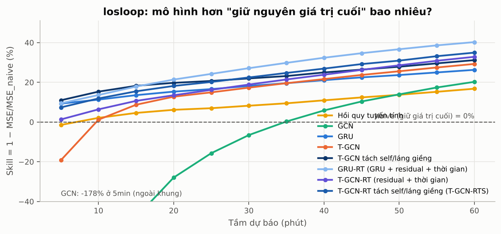

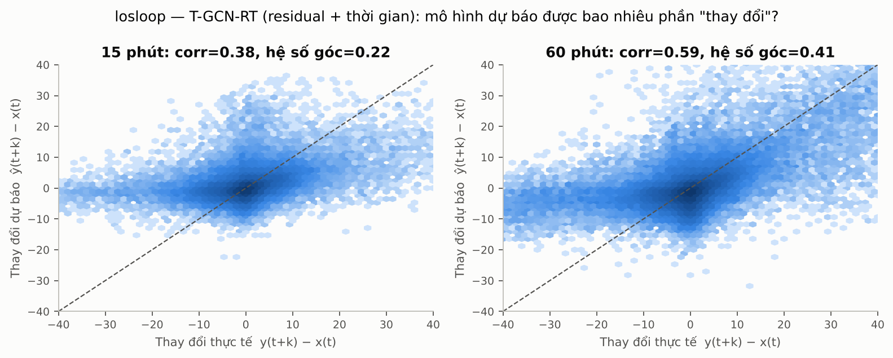

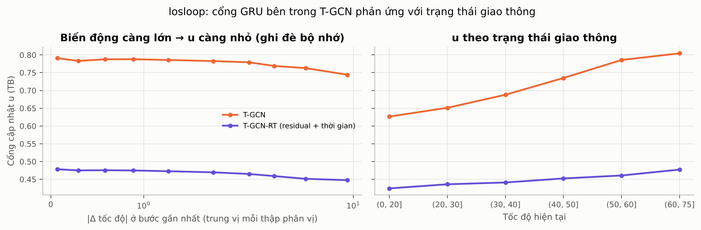

### 7.5 Vì sao dữ liệu này hạn chế lợi ích của đồ thị

Ngay ở bước EDA (mục 2.2), tương quan của *biến động* 5 phút giữa hai nút kề chỉ 0.066: láng giềng cho biết mức tốc độ chung của khu vực nhưng gần như không báo trước dao động kế tiếp. Cộng với chỉ 5 ngày train, mô hình có thêm thông tin không gian dễ học các mẫu trùng hợp hơn là quy luật (T-GCN-RT tách self dừng sớm ở epoch 18; T-GCN+ không học được gì từ đồ thị thích nghi). Đồ thị chỉ có lợi rõ ràng ở các sự kiện biến động mạnh (mục 5.3) và ở tầm xa.


## 8. Đánh giá độ tin cậy của mô hình

### 8.1 Độ ổn định theo seed

| Mô hình | seed | RMSE | CV RMSE | MAE | epoch chọn |
|---|---|---|---|---|---|
| GRU-RT (GRU + residual + thời gian) | 3 | **6.981** ± 0.063 | 0.91% | **4.065** ± 0.063 | [37, 19, 33] |
| GRU-RT, loss đơn vị gốc | 3 | **7.143** ± 0.244 | 3.41% | **4.087** ± 0.068 | [13, 53, 35] |
| T-GCN-RT tách self/láng giềng (T-GCN-RTS) | 3 | **7.219** ± 0.054 | 0.75% | **4.156** ± 0.052 | [26, 21, 18] |
| T-GCN tách self/láng giềng | 3 | **7.295** ± 0.060 | 0.83% | **4.124** ± 0.019 | [35, 42, 64] |
| T-GCN-RT (residual + thời gian) | 3 | **7.375** ± 0.043 | 0.58% | **4.325** ± 0.029 | [29, 31, 33] |
| GRU | 3 | **7.495** ± 0.006 | 0.08% | **4.175** ± 0.023 | [87, 93, 101] |
| T-GCN gốc — *baseline* | 3 | 7.516 ± 0.031 | 0.41% | 4.371 ± 0.037 | [78, 96, 65] |
| GCN | 3 | 8.606 ± 0.009 | 0.10% | 5.345 ± 0.009 | [108, 103, 105] |

*Số in đậm = tốt hơn T-GCN gốc (dòng baseline) ở cùng cột, so ở đúng số chữ số hiển thị; sai số thấp hơn là tốt hơn.* *(Chỉ so cột RMSE và MAE.)*

Độ lệch chuẩn giữa các seed nhỏ (CV ≤ 1%) với mọi cấu hình chính — ngoại lệ duy nhất là GRU-RT với loss đơn vị gốc (CV 3.4%, một seed kém hẳn), đó là lý do biến thể này bị loại. Các độ lệch này nhỏ, nhưng **cùng cỡ với nhiều khác biệt mà bài báo dùng để kết luận** (ví dụ T-GCN hơn GRU 1.8% RMSE ở "15 phút"). Ensemble 3 seed luôn cải thiện nhẹ và có ý nghĩa (GRU-RT: 6.98 → 6.91, DM p < 10⁻⁴).

### 8.2 Khác biệt nào có ý nghĩa thống kê?

Kiểm định cặp trên cùng các mẫu test: bootstrap khối dịch chuyển (khối 12 mẫu = 1 giờ, giữ tự tương quan) cho KTC 95% của ΔRMSE, và kiểm định Diebold–Mariano (phương sai Newey–West). Sai số mỗi mẫu được lấy trung bình qua 3 seed.

| A | B | RMSE A | RMSE B | ΔRMSE (A−B) | KTC 95% | DM p | Kết luận |
|---|---|---|---|---|---|---|---|
| T-GCN | GRU | 7.516 | 7.495 | +0.022 | [-0.115; +0.153] | 0.7626 | không khác biệt |
| T-GCN | Naive (giữ giá trị cuối) | 7.516 | 8.418 | -0.902 | [-1.542; -0.389] | 0.0040 | A tốt hơn |
| GRU | Naive (giữ giá trị cuối) | 7.495 | 8.418 | -0.923 | [-1.542; -0.399] | 0.0037 | A tốt hơn |
| T-GCN | Hồi quy tuyến tính | 7.516 | 7.944 | -0.427 | [-0.690; -0.185] | 0.0025 | A tốt hơn |
| T-GCN-RT (residual + thời gian) | T-GCN | 7.375 | 7.516 | -0.141 | [-0.387; +0.109] | 0.2794 | không khác biệt |
| T-GCN-RT (residual + thời gian) | Naive (giữ giá trị cuối) | 7.375 | 8.418 | -1.043 | [-1.705; -0.528] | 0.0009 | A tốt hơn |
| T-GCN-RT (residual + thời gian) | GRU-RT (GRU + residual + thời gian) | 7.375 | 6.981 | +0.394 | [+0.211; +0.667] | 0.0026 | B tốt hơn |
| T-GCN-RT (residual + thời gian) | Hồi quy tuyến tính | 7.375 | 7.944 | -0.569 | [-1.000; -0.163] | 0.0126 | A tốt hơn |
| GRU-RT (GRU + residual + thời gian) | GRU | 6.981 | 7.495 | -0.513 | [-0.785; -0.253] | 0.0007 | A tốt hơn |
| GRU-RT (GRU + residual + thời gian) | Naive (giữ giá trị cuối) | 6.981 | 8.418 | -1.437 | [-2.180; -0.872] | < 0.0001 | A tốt hơn |
| T-GCN tách self/láng giềng | GRU | 7.295 | 7.495 | -0.199 | [-0.337; -0.072] | 0.0097 | A tốt hơn |
| T-GCN tách self/láng giềng | T-GCN | 7.295 | 7.516 | -0.221 | [-0.334; -0.117] | 0.0006 | A tốt hơn |
| T-GCN-RT tách self/láng giềng (T-GCN-RTS) | T-GCN-RT (residual + thời gian) | 7.220 | 7.375 | -0.156 | [-0.361; +0.021] | 0.1320 | không khác biệt |
| T-GCN-RT tách self/láng giềng (T-GCN-RTS) | GRU-RT (GRU + residual + thời gian) | 7.220 | 6.981 | +0.238 | [+0.109; +0.377] | 0.0024 | B tốt hơn |
| Ensemble T-GCN-RT (3 seed) | T-GCN-RT (residual + thời gian) | 7.266 | 7.375 | -0.109 | [-0.160; -0.071] | < 0.0001 | A tốt hơn |
| Ensemble GRU-RT (3 seed) | GRU-RT (GRU + residual + thời gian) | 6.911 | 6.981 | -0.071 | [-0.092; -0.054] | < 0.0001 | A tốt hơn |
| Ensemble GRU-RT + T-GCN-RTS | Ensemble GRU-RT (3 seed) | 6.928 | 6.911 | +0.017 | [-0.032; +0.066] | 0.4974 | không khác biệt |

Kết luận: (i) mọi mô hình học sâu vượt persistence có ý nghĩa; (ii) **T-GCN gốc và GRU không khác nhau có ý nghĩa** (p = 0.76), nhưng **T-GCN tách self/láng giềng tốt hơn cả hai** (p = 0.010 và p < 0.001); (iii) residual + thời gian cải thiện GRU có ý nghĩa (p < 0.001); (iv) trong cấu hình RT, GRU-RT tốt hơn cả T-GCN-RT (p = 0.003) lẫn T-GCN-RTS (p = 0.002); (v) ensemble hỗn hợp GRU-RT + T-GCN-RTS không hơn ensemble GRU-RT (p = 0.50).

Lưu ý: tập test của Los-loop chỉ là ~1.4 ngày (2 đợt cao điểm chiều, 1 đợt sáng). Các KTC trên phản ánh bất định *trong* giai đoạn đó, không bảo đảm cho tuần khác, mùa khác hay ngày lễ.

### 8.3 Độ bền khi dữ liệu đầu vào xấu

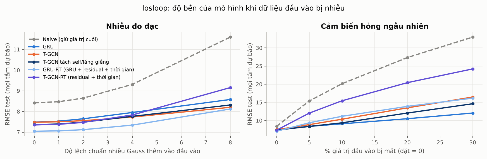

- **Nhiễu đo đạc:** mọi mô hình suy giảm chậm hơn persistence. Trong nhóm không residual, **các mô hình có đồ thị bền hơn GRU** (σ = 8 mph: T-GCN 8.20, T-GCN tách self 8.32, GRU 8.58): tích chập đồ thị trung bình hóa nhiễu độc lập giữa các cảm biến — một lợi ích thật của đồ thị mà sai số trên dữ liệu sạch không cho thấy.
- **Cảm biến hỏng (đầu vào = 0):** các mô hình residual **rất mong manh** (5% đầu vào hỏng: T-GCN-RT 7.35 → 12.0; GRU-RT 7.05 → 9.4) vì chúng cộng thẳng giá trị cuối (= 0). GRU thường và T-GCN tách self bền nhất (5% hỏng: 8.39 và 8.37). ⇒ Khi triển khai mô hình residual **bắt buộc** phải kiểm tra/điền giá trị thiếu trước khi dự báo.

### 8.4 Khoảng dự báo có đáng tin không? (conformal)

Dùng phần dư trên validation để dựng khoảng dự báo 90% (split conformal, theo từng tầm; biến thể theo từng tầm × từng nút):

| Mô hình | tầm | độ phủ tổng (%) | cao điểm (%) | ngoài cao điểm (%) | độ rộng TB (mph) |
|---|---|---|---|---|---|
| GRU | 15 phút | 87.0 | 78.9 | 89.6 | 13.0 |
| GRU | 30 phút | 85.6 | 73.7 | 89.4 | 14.7 |
| GRU | 60 phút | 84.5 | 68.5 | 89.7 | 18.1 |
| T-GCN | 15 phút | 86.6 | 75.4 | 90.2 | 14.3 |
| T-GCN | 30 phút | 85.6 | 72.8 | 89.7 | 15.8 |
| T-GCN | 60 phút | 85.0 | 70.0 | 89.9 | 19.0 |
| GRU-RT (GRU + residual + thời gian) | 15 phút | 87.0 | 80.5 | 89.2 | 12.6 |
| GRU-RT (GRU + residual + thời gian) | 30 phút | 87.0 | 78.3 | 89.8 | 14.6 |
| GRU-RT (GRU + residual + thời gian) | 60 phút | 87.1 | 73.8 | 91.4 | 18.6 |
| T-GCN-RT (residual + thời gian) | 15 phút | 86.6 | 78.5 | 89.2 | 13.7 |
| T-GCN-RT (residual + thời gian) | 30 phút | 86.0 | 75.7 | 89.3 | 15.5 |
| T-GCN-RT (residual + thời gian) | 60 phút | 86.2 | 73.3 | 90.3 | 19.2 |

Độ phủ thực tế 85–87% (thấp hơn mục tiêu 90%) và chỉ **69–79% trong giờ cao điểm** — vì phân phối sai số thay đổi giữa validation (sáng thứ Ba) và test (chiều thứ Ba–thứ Tư). Khoảng dự báo dùng được ngoài cao điểm (≈ 89–90%), nhưng cần hiệu chỉnh theo giờ (conformal có điều kiện) nếu dùng cho cảnh báo kẹt xe.

### 8.5 Các kiểm tra khác

- **Điểm nội suy:** loại 4.6% mục tiêu test nằm trên đoạn nội suy thẳng làm RMSE của mọi mô hình tăng ~0.06–0.10 (các điểm nội suy "dễ" hơn), thứ hạng không đổi.
- **Độ lệch theo mức tốc độ** (Hình 18): khi thực tế ≤ 20 mph, GRU/T-GCN dự báo cao hơn trung bình ~9 mph; khi thông thoáng (> 60 mph) thấp hơn ~1.4 mph. Mô hình "co về trung bình"; độ tin cậy thấp nhất đúng lúc cần nhất (kẹt xe).
- **Độ lạc quan của việc chọn epoch theo test:** trung bình 1.1% RMSE trên 37 run; 0.3–0.5% với GCN/GRU/T-GCN nhưng 2–5.6% với các biến thể dễ quá khớp (mục 4.1).

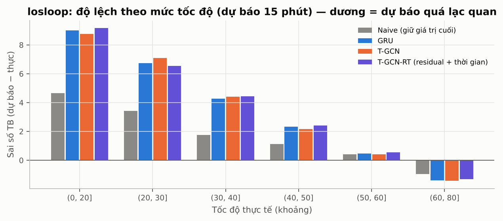


## 9. So sánh với bài báo

### 9.1 Cùng cách tính của bài báo ("15 phút" = trung bình các bước 1…k)

Los-loop, giao thức nghiêm ngặt của chúng tôi (chọn epoch bằng validation), so với Bảng 1 của Zhao et al. (chọn epoch bằng test). Mỗi ô: RMSE / MAE / Accuracy / R².

| Mô hình | nguồn | 15 phút | 30 phút | 45 phút | 60 phút |
|---|---|---|---|---|---|
| HA (TB cửa sổ) | bài báo | 7.443 / 4.014 / 0.873 / 0.712 | 7.443 / 4.014 / 0.873 / 0.712 | 7.443 / **4.014** / 0.873 / 0.712 | 7.443 / **4.014** / 0.873 / 0.712 |
| HA (TB cửa sổ) | chúng tôi | 7.494 / 3.974 / 0.872 / 0.708 | 8.308 / 4.367 / 0.858 / 0.641 | 9.040 / 4.738 / 0.846 / 0.574 | 9.713 / 5.095 / 0.835 / 0.508 |
| Hồi quy tuyến tính (SVR) | bài báo | 6.008 / 3.728 / 0.898 / 0.812 | 6.959 / **3.725** / 0.881 / 0.749 | 7.750 / 4.129 / 0.868 / 0.690 | 8.439 / **4.504** / 0.856 / 0.634 |
| Hồi quy tuyến tính | chúng tôi | 5.489 / **3.176** / 0.906 / 0.843 | 6.520 / **3.704** / 0.889 / 0.779 | 7.301 / 4.138 / 0.876 / 0.722 | 7.944 / **4.514** / 0.865 / 0.671 |
| GCN | bài báo | 7.792 / 5.353 / 0.867 / 0.684 | 8.335 / 5.612 / 0.858 / 0.640 | 8.804 / 5.953 / 0.850 / 0.600 | 9.266 / 6.289 / 0.842 / 0.558 |
| GCN | chúng tôi | 7.633 / 4.743 / 0.870 / 0.697 | 7.959 / 4.949 / 0.864 / 0.670 | 8.286 / 5.152 / 0.859 / 0.642 | 8.606 / 5.345 / 0.853 / 0.614 |
| GRU | bài báo | 5.218 / **3.060** / 0.911 / 0.858 | 6.280 / **3.651** / 0.893 / 0.796 | 7.034 / **4.091** / 0.880 / 0.745 | 7.662 / **4.519** / 0.869 / 0.698 |
| GRU | chúng tôi | 5.217 / **2.965** / 0.911 / 0.858 | 6.181 / **3.443** / 0.895 / 0.801 | 6.899 / **3.833** / 0.883 / 0.752 | 7.495 / **4.175** / 0.872 / 0.707 |
| T-GCN — *baseline* | bài báo | 5.126 / 3.180 / 0.913 / 0.863 | 6.060 / 3.747 / 0.897 / 0.810 | 6.707 / 4.116 / 0.886 / 0.768 | 7.268 / 4.602 / 0.876 / 0.728 |
| T-GCN | chúng tôi | 5.552 / 3.361 / 0.905 / 0.840 | 6.363 / 3.749 / 0.892 / 0.789 | 6.996 / **4.082** / 0.881 / 0.745 | 7.516 / **4.371** / 0.872 / 0.706 |
| Naive (giữ giá trị cuối) | chúng tôi | 5.558 / **3.149** / 0.905 / 0.839 | 6.710 / **3.628** / 0.886 / 0.766 | 7.621 / **4.033** / 0.870 / 0.698 | 8.418 / **4.408** / 0.857 / 0.631 |
| GRU-RT (GRU + residual + thời gian) | chúng tôi | 5.135 / **3.052** / 0.913 / 0.863 | **5.958** / **3.472** / **0.899** / **0.815** | **6.529** / **3.791** / **0.889** / **0.778** | **6.981** / **4.065** / **0.881** / **0.746** |
| Ensemble GRU-RT (3 seed) | chúng tôi | **5.090** / **3.008** / 0.913 / **0.865** | **5.905** / **3.425** / **0.899** / **0.819** | **6.466** / **3.740** / **0.890** / **0.782** | **6.911** / **4.012** / **0.882** / **0.751** |

*Số in đậm = tốt hơn T-GCN trong Bảng 1 của bài báo (dòng baseline) ở cùng cột, so ở đúng số chữ số hiển thị; RMSE, MAE thấp hơn và Accuracy, R² cao hơn là tốt hơn.*

- **HA, GCN, GRU tái lập sát bài báo**; HA trung bình cửa sổ của chúng tôi gần như trùng HA của tác giả ở "15 phút" (7.49 / 3.97 so với 7.44 / 4.01), xác nhận cách hiểu "HA = trung bình 12 bước đầu vào".
- **Hồi quy tuyến tính của chúng tôi tốt hơn SVR của bài báo** (5.49 so với 6.01 ở 15 phút) — baseline của bài báo yếu hơn mức có thể đạt.
- **T-GCN của chúng tôi kém con số bài báo** (5.55 so với 5.13 ở 15 phút; 7.52 so với 7.27 ở 60 phút). Mục 9.2 kiểm tra xem bao nhiêu phần đến từ giao thức.
- **Mô hình cải tiến (ensemble GRU-RT) vượt mọi con số của bài báo**: "15 phút" 5.09 / 3.01 (bài báo T-GCN 5.13 / 3.18), "60 phút" 6.91 / 4.01 (7.27 / 4.60) — dưới giao thức chặt hơn và ít dữ liệu train hơn.

### 9.2 Tái lập đúng giao thức của tác giả

Chúng tôi chạy lại GRU và T-GCN theo **đúng giao thức trong mã của tác giả** (`--protocol paper`): chia 80/20 không có validation, chuẩn hóa chia cho max của toàn chuỗi, cửa sổ test nằm trọn trong 20% cuối, lr 10⁻³ cố định, batch 32, hidden 64 (Los-loop) / 100 (SZ-taxi), dự báo pre_len = 3 bước (Los-loop, "15 phút") và 1 bước (SZ-taxi), **giữ epoch có RMSE test nhỏ nhất**. Do giới hạn CPU, chúng tôi train 300 epoch (Los-loop) và 150 epoch (SZ-taxi) — 5–10% so với 3000 epoch của tác giả.

| Bộ dữ liệu | Mô hình | epoch train | Chúng tôi (RMSE / MAE) | Bài báo (RMSE / MAE) | Accuracy / R² — chúng tôi | Accuracy / R² — bài báo |
|---|---|---|---|---|---|---|
| losloop | Naive (giữ giá trị cuối) | — | 5.543 / **3.156** | — (không báo cáo) | — | — |
| losloop | HA (TB cửa sổ) | — | 7.475 / 3.972 | 7.443 / 4.014 | — | — |
| losloop | GRU | 300 (tốt nhất: 297) | 5.233 / **2.974** | 5.218 / **3.060** | 0.911 / 0.857 | 0.911 / 0.858 |
| losloop | T-GCN | 300 (tốt nhất: 297) | 5.356 / 3.247 | 5.126 / 3.180 *(baseline)* | 0.909 / 0.851 | 0.913 / 0.863 *(baseline)* |
| sztaxi | Naive (giữ giá trị cuối) | — | 5.260 / 3.317 | — (không báo cáo) | — | — |
| sztaxi | HA (TB cửa sổ) | — | 4.174 / 2.739 | 7.920 / 5.497 | — | — |
| sztaxi | GRU | 150 (tốt nhất: 150) | 4.104 / 2.741 | 4.048 / **2.681** | 0.714 / 0.846 | 0.718 / 0.850 |
| sztaxi | T-GCN | 150 (tốt nhất: 150) | 4.404 / 3.074 | 3.916 / 2.706 *(baseline)* | 0.693 / 0.822 | 0.731 / 0.854 *(baseline)* |

*Số in đậm = tốt hơn T-GCN trong bài báo, cùng bộ dữ liệu, "15 phút" (ô đánh dấu baseline) ở cùng cột, so ở đúng số chữ số hiển thị; RMSE, MAE thấp hơn và Accuracy, R² cao hơn là tốt hơn.*

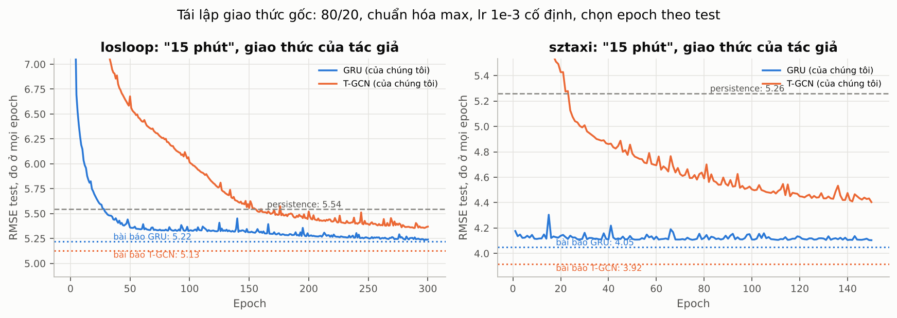

Nhận xét:

- **GRU tái lập được bài báo ngay cả với ít epoch** (bão hòa sớm). **T-GCN hội tụ rất chậm** dưới chuẩn hóa max và lr cố định: Los-loop 6.01 (epoch 100) → 5.52 (200) → 5.36 (300), vẫn đang giảm; với 3000 epoch có thể tiến tới con số 5.13 của bài báo. Chúng tôi không ngoại suy; điều chắc chắn là ở cùng ngân sách huấn luyện, T-GCN chưa vượt GRU.
- **Ngay cả dưới giao thức của tác giả, MAE của T-GCN (3.25) vẫn kém persistence (3.16)** trên đúng các cửa sổ test đó — điểm P4 không phụ thuộc vào cách chúng tôi huấn luyện.
- Trên SZ-taxi, GRU tái lập sát bài báo (4.10 / 2.74 so với 4.05 / 2.68) ngay từ những epoch đầu, còn T-GCN sau 150 epoch (4.40, epoch tốt nhất là epoch cuối) vẫn kém trung bình trượt 3 giờ trên cùng cửa sổ (4.17 / 2.74). Với chuỗi nhiễu như SZ-taxi, gần như toàn bộ "kỹ năng" mà bài báo báo cáo đạt được bằng một trung bình trượt (P6b).
- Giao thức nghiêm ngặt của chúng tôi (z-score theo train, lr cosine, dừng sớm bằng validation) cho T-GCN hội tụ trong ~100 epoch; đây là lý do chúng tôi dùng nó cho mọi so sánh chính.

### 9.3 Tóm tắt các giả thuyết

| Giả thuyết | Kết luận | Bằng chứng chính |
|---|---|---|
| H1 – Đồ thị có ích (T-GCN > GRU) | **Bác bỏ ở dạng gốc; đúng sau khi sửa** | T-GCN gốc ≈ GRU (p = 0.76), MAE kém hơn; dạng tách self/láng giềng tốt hơn GRU có ý nghĩa (p = 0.01); đồ thị giúp ở tầm xa, biến động mạnh, dữ liệu nhiễu — nhưng không cộng thêm khi đã có residual + thời gian |
| H2 – Học sâu > baseline đơn giản | **Đúng tổng thể, sai ở giờ cao điểm** | Mọi mô hình vượt persistence (p < 0.005), nhưng trong giờ cao điểm persistence có MAE thấp nhất |
| H3 – Con số bài báo đáng tin | **Lạc quan** | Chọn epoch theo test, gộp tầm dự báo, không baseline persistence, không độ biến thiên |
| H4 – Có thể cải tiến | **Đúng** | Residual + thời gian (+ ensemble 3 seed): −7.8% RMSE so với GRU, −8.0% so với T-GCN, có ý nghĩa thống kê; tách self/láng giềng giúp T-GCN |

## 10. Kiểm chứng trên SZ-taxi

Chúng tôi lặp lại giai đoạn 1–2 (3 seed) và các cải tiến chính (1 seed) trên SZ-taxi — bộ dữ liệu khác hẳn Los-loop: đường đô thị, tốc độ ước lượng từ taxi (rất nhiễu, tự tương quan 15 phút chỉ 0.41), 24.8% giá trị bằng 0 (thiếu quan sát), đồ thị có hướng và thưa (bậc 3.4). Hidden = 64, L = 12 (3 giờ), H = 4 (15…60 phút).

**Tất cả mục tiêu (cách chấm của bài báo, gồm cả số 0):**

| Mô hình | seed | RMSE val (chọn) | RMSE TB | MAE TB | 15 phút RMSE | 15 phút MAE | 60 phút RMSE | 60 phút MAE |
|---|---|---|---|---|---|---|---|---|
| Naive (giữ giá trị cuối) | 1 | — | 5.391 | 3.412 | 5.246 | 3.310 | 5.508 | 3.494 |
| HA (TB cửa sổ) | 1 | — | 4.240 | **2.786** | 4.163 | **2.731** | 4.310 | **2.837** |
| HA theo giờ | 1 | — | 6.169 | 4.617 | 6.165 | 4.614 | 6.173 | 4.620 |
| Hồi quy tuyến tính | 1 | — | **4.221** | 2.883 | **4.117** | 2.789 | 4.313 | 2.966 |
| GCN | 3 | 4.206 ± 0.002 | 4.371 ± 0.004 | 2.963 ± 0.006 | 4.316 ± 0.003 | 2.925 ± 0.007 | 4.425 ± 0.011 | 3.002 ± 0.014 |
| GRU | 3 | **3.970** ± 0.003 | **4.179** ± 0.005 | **2.775** ± 0.008 | **4.089** ± 0.006 | **2.715** ± 0.015 | **4.258** ± 0.008 | **2.828** ± 0.010 |
| T-GCN gốc — *baseline* | 3 | 4.019 ± 0.004 | 4.225 ± 0.005 | 2.825 ± 0.005 | 4.156 ± 0.004 | 2.782 ± 0.004 | 4.286 ± 0.007 | 2.864 ± 0.008 |
| GRU-RT (GRU + residual + thời gian) | 1 | **3.977** | **4.172** | **2.772** | **4.083** | **2.699** | **4.245** | **2.830** |
| T-GCN-RT (residual + thời gian) | 1 | 4.583 | 4.786 | 3.246 | 4.679 | 3.158 | 4.866 | 3.316 |
| T-GCN (loss bỏ qua 0) | 1 | 4.499 | 4.379 | 3.111 | 4.304 | 3.059 | 4.438 | 3.145 |
| T-GCN-RT (loss bỏ qua 0) | 1 | 5.044 | 4.904 | 3.435 | 4.796 | 3.352 | 4.977 | 3.489 |

*Số in đậm = tốt hơn T-GCN gốc (dòng baseline) ở cùng cột, so ở đúng số chữ số hiển thị; sai số thấp hơn là tốt hơn.*

*RMSE validation của hai biến thể "loss bỏ qua 0" được tính trên mục tiêu ≠ 0 nên không so trực tiếp với các dòng khác.*

**Chỉ mục tiêu ≠ 0 (có ý nghĩa thực tế):**

| Mô hình | seed | RMSE val (chọn) | RMSE TB | MAE TB | 15 phút RMSE | 15 phút MAE | 60 phút RMSE | 60 phút MAE |
|---|---|---|---|---|---|---|---|---|
| Naive (giữ giá trị cuối) | 1 | — | 6.012 | 4.262 | 5.844 | 4.137 | 6.147 | 4.364 |
| HA (TB cửa sổ) | 1 | — | 4.743 | 3.372 | 4.658 | 3.305 | 4.821 | 3.436 |
| HA theo giờ | 1 | — | 6.674 | 5.170 | 6.670 | 5.167 | 6.679 | 5.173 |
| Hồi quy tuyến tính | 1 | — | **4.661** | 3.348 | **4.554** | **3.255** | **4.755** | 3.431 |
| GCN | 3 | 4.206 ± 0.002 | 4.860 ± 0.001 | 3.502 ± 0.003 | 4.804 ± 0.001 | 3.455 ± 0.003 | 4.914 ± 0.005 | 3.547 ± 0.008 |
| GRU | 3 | **3.970** ± 0.003 | **4.619** ± 0.001 | **3.269** ± 0.002 | **4.522** ± <0.001 | **3.191** ± 0.005 | **4.703** ± 0.004 | **3.337** ± 0.004 |
| T-GCN gốc — *baseline* | 3 | 4.019 ± 0.004 | 4.694 ± 0.004 | 3.346 ± 0.004 | 4.618 ± 0.004 | 3.287 ± 0.004 | 4.762 ± 0.005 | 3.400 ± 0.006 |
| GRU-RT (GRU + residual + thời gian) | 1 | **3.977** | **4.615** | **3.265** | **4.526** | **3.191** | **4.691** | **3.328** |
| T-GCN-RT (residual + thời gian) | 1 | 4.583 | 5.280 | 3.780 | 5.161 | 3.683 | 5.367 | 3.854 |
| T-GCN (loss bỏ qua 0) | 1 | 4.499 | 4.722 | 3.406 | 4.640 | 3.342 | 4.791 | 3.458 |
| T-GCN-RT (loss bỏ qua 0) | 1 | 5.044 | 5.297 | 3.806 | 5.175 | 3.709 | 5.387 | 3.878 |

*Số in đậm = tốt hơn T-GCN gốc (dòng baseline) ở cùng cột, so ở đúng số chữ số hiển thị; sai số thấp hơn là tốt hơn.*

Nhận xét:

- **Cùng kết luận với Los-loop: T-GCN không vượt GRU** — trên SZ-taxi còn kém hơn có ý nghĩa (mục tiêu ≠ 0: 4.69 so với 4.62; kiểm định cặp trên sai số trung bình 3 seed: ΔRMSE +0.07, KTC 95% [+0.06; +0.09], DM p < 10⁻⁴). Theo validation, mô hình cuối cho SZ-taxi là **ensemble 3 seed GRU** (RMSE val 3.970, GRU-RT 3.977).
- **Học sâu chỉ hơn trung bình trượt rất ít:** GRU 4.18 / 2.78 so với trung bình 12 bước đầu vào 4.24 / 2.79 (gồm số 0); 4.62 / 3.27 so với 4.74 / 3.37 (bỏ số 0). Persistence rất tệ (5.39) vì giá trị cuối nhiễu và hay bằng 0. Chuỗi SZ-taxi gần như "mức trung bình + nhiễu" ở độ phân giải 15 phút, nên trung bình hóa (theo thời gian hoặc theo láng giềng) là gần tối ưu.
- **Residual không giúp, thậm chí phá T-GCN:** GRU-RT = GRU (p = 0.57), còn T-GCN-RT tệ hẳn (4.79). Với chuỗi nhiễu, mô hình phải học *triệt tiêu* phần x_t được cộng vào (Δ̂ ≈ mức trung bình − x_t), điều cần biết chính xác x_t — GRU làm được, T-GCN chỉ thấy ~26% giá trị của chính nút sau  nên không làm được. Đây là thêm một hệ quả của hiện tượng "loãng tín hiệu" (mục 7.3), và cho thấy cải tiến tốt trên Los-loop (chuỗi mượt, tự tương quan 0.82) **không tự động chuyển sang** dữ liệu nhiễu.
- **Loss bỏ qua số 0 không cải thiện** (T-GCN: 4.72 so với 4.69 trên mục tiêu ≠ 0), có lẽ vì đầu vào vẫn chứa số 0 và mô hình mất đi một phần tư tín hiệu huấn luyện. Cách xử lý đúng hơn là điền giá trị thiếu ở *đầu vào* (ví dụ bằng trung bình láng giềng hoặc theo giờ) — hướng phát triển.
- **Đồ thị lại có ích khi tốc độ biến động mạnh** (MAE 15 phút với |Δ| > 10: T-GCN 8.50, GCN 8.62 so với GRU 9.05, persistence 14.3) — đúng như Los-loop. Trên SZ-taxi không có giờ cao điểm rõ rệt (MAE cao điểm ≈ ngoài cao điểm).
- Dưới giao thức của tác giả (mục 9.2), GRU tái lập sát bài báo (4.10 so với 4.05), T-GCN sau 150 epoch vẫn chưa hội tụ (4.40 so với 3.92).


## 11. Cải tiến nâng cao: kiến thức và công nghệ mới

### 11.1 Ý tưởng — bốn hướng thử

Sau mục 5, mô hình tốt nhất là ensemble GRU-RT (RMSE 6.91 / MAE 4.01) và điểm yếu chung là giờ cao điểm. Chúng tôi thử thêm bốn hướng, **cùng giao thức nghiêm ngặt** (70/10/20, thống kê chỉ từ train, chọn theo validation, 3 seed):

| Hướng | Mô hình | Ý tưởng chính |
|---|---|---|
| A. Kiến trúc hiện đại (2018–2023) | **STID** (Shao et al., 2022) | MLP + embedding "danh tính" của cảm biến, giờ trong ngày, thứ — không đồ thị, không hồi quy |
| | **DCRNN-lite** (Li et al., 2018 — bài thứ 2 trong Papers.xlsx) | GRU với diffusion convolution hai chiều K = 2, *giữ trọng số riêng cho chính nút* (k = 0) |
| | **Graph WaveNet** (Wu et al., 2019) | TCN giãn nở có cổng + GCN khuếch tán + đồ thị thích nghi |
| | **STAEformer** (Liu et al., 2023) | Transformer theo thời gian và theo nút + embedding thích nghi không gian–thời gian |
| B. Khai phá dữ liệu cổ điển | **LightGBM** + đặc trưng không gian–thời gian | ~50 đặc trưng thiết kế tay: độ trễ, thống kê trượt, trung bình láng giềng (Âx), lịch, **hồ sơ tốc độ theo khung giờ của từng cảm biến** (tính từ train); một mô hình cây tăng cường cho mỗi tầm, dự báo phần thay đổi |
| C. Chuyển kiến thức B → học sâu | **GRU-RTP**, **T-GCN-RTSP** | thêm hồ sơ theo giờ của cảm biến làm đầu vào và "thay đổi hồ sơ dự kiến tới t+k" vào đầu ra |
| D. Kết hợp | **Trộn theo từng tầm** | trọng số không âm (tổng 1) cho từng tầm dự báo, **tối ưu trên validation**, rồi mới áp dụng lên test |

Trên CPU của chúng tôi, Graph WaveNet bản gọn chạy 1 seed không residual và 3 seed có residual (≈ 30–50 phút/run). STAEformer (83–390 s/epoch trên CPU) và các cỡ đầy đủ theo bài gốc được **chạy trên GPU máy của bạn**: 7 cấu hình × 3 seed × 2 bộ dữ liệu = 42 run, cùng giao thức (`run_suite.py --groups modern_gpu`, `LOCAL_RUN.md`). Các dòng "(GPU)" trong các bảng dưới là các run đó; mục 11.8 kiểm tra số liệu và phân tích riêng.

### 11.2 Kết quả trên Los-loop

| Mô hình | nhóm | seed | tham số | RMSE val | RMSE test | MAE test | 15 phút | 60 phút | phút/run |
|---|---|---|---|---|---|---|---|---|---|
| Trộn theo tầm: LightGBM + Graph WaveNet-res + GRU-RT + T-GCN-RTSP | ensemble | 3 | — | — | **6.190** | **3.494** | **5.37** / **3.08** | **7.20** / **4.11** | — |
| Ensemble LightGBM v2, 127 lá (chọn theo val) (3 seed) | ensemble | 3 | — | — | **6.438** | **3.578** | **5.63** / **3.17** | **7.46** / **4.21** | — |
| Ensemble LightGBM + GRU-RTP (+ hồ sơ giờ) | ensemble | 3 | — | — | **6.452** | **3.726** | **5.65** / **3.30** | **7.49** / **4.41** | — |
| LightGBM v2, 127 lá (chọn theo val) | khai phá dữ liệu | 3 | — | **5.339** | **6.467** ± <0.001 | **3.595** ± 0.005 | **5.66** / **3.19** | **7.48** / **4.22** | 5 |
| LightGBM (đặc trưng KG-TG) | khai phá dữ liệu | 3 | — | **5.353** | **6.477** ± 0.020 | **3.618** ± 0.015 | **5.66** / **3.20** | **7.49** / **4.24** | 4 |
| LightGBM v2 (+ bất thường láng giềng/toàn mạng) | khai phá dữ liệu | 1 | — | **5.348** | **6.481** | **3.613** | **5.67** / **3.20** | **7.54** / **4.27** | 6 |
| Graph WaveNet + residual (GPU) | hiện đại (GPU) | 3 | 165,624 | — | **6.565** ± 0.052 | **3.741** ± 0.041 | **5.58** / **3.23** | **7.78** / **4.49** | — |
| Graph WaveNet + residual | hiện đại | 3 | 165,624 | **5.370** | **6.589** ± 0.117 | **3.674** ± 0.035 | **5.60** / **3.20** | **7.75** / **4.35** | 36 |
| T-GCN-RTSP (+ hồ sơ giờ) | hồ sơ giờ | 3 | 27,996 | **5.664** | **6.685** ± 0.026 | **4.100** ± 0.091 | **5.81** / **3.54** | **7.82** / **4.96** | 20 |
| Graph WaveNet cỡ đầy đủ + residual (GPU) | hiện đại (GPU) | 3 | 301,048 | — | **6.685** ± 0.129 | **3.736** ± 0.062 | **5.63** / **3.22** | **7.93** / **4.46** | — |
| Graph WaveNet (GPU) | hiện đại (GPU) | 3 | 165,624 | — | **6.693** ± 0.061 | **3.904** ± 0.051 | **5.65** / **3.35** | **8.03** / **4.71** | — |
| Graph WaveNet cỡ đầy đủ (GPU) | hiện đại (GPU) | 3 | 301,048 | — | **6.752** ± 0.165 | **3.894** ± 0.138 | **5.68** / **3.36** | **8.02** / **4.64** | — |
| Ensemble GRU-RTP (+ hồ sơ giờ) (3 seed) | ensemble | 3 | — | — | **6.809** | **4.034** | **5.97** / **3.55** | **7.93** / **4.81** | — |
| GRU-RTP (+ hồ sơ giờ) | hồ sơ giờ | 3 | 14,748 | **5.652** | **6.829** ± 0.006 | **4.054** ± 0.054 | **5.99** / **3.57** | **7.95** / **4.83** | 18 |
| Graph WaveNet | hiện đại | 1 | 165,624 | **5.592** | **6.860** | **4.164** | **5.85** / 3.68 | **8.06** / **4.87** | 42 |
| Ensemble GRU-RT (3 seed) | ensemble | 3 | — | — | **6.911** | **4.012** | **5.80** / **3.38** | **8.29** / **4.97** | — |
| GRU-RT | phần 1 | 3 | 14,412 | **5.906** | **6.981** ± 0.063 | **4.065** ± 0.063 | **5.84** / **3.43** | **8.39** / **5.04** | 13 |
| T-GCN-RTS | phần 1 | 3 | 27,468 | **5.937** | **7.219** ± 0.054 | **4.156** ± 0.052 | **5.93** / **3.50** | **8.75** / **5.11** | 13 |
| STAEformer cỡ đầy đủ (GPU) | hiện đại (GPU) | 3 | 1,258,932 | — | **7.220** ± 0.431 | **4.051** ± 0.173 | 6.20 / **3.55** | **8.45** / **4.74** | — |
| T-GCN tách self | phần 1 | 3 | 25,932 | **6.091** | **7.295** ± 0.060 | **4.124** ± 0.019 | **5.83** / **3.35** | **9.00** / **5.24** | 27 |
| T-GCN-RT | phần 1 | 3 | 14,220 | **6.158** | **7.375** ± 0.043 | **4.325** ± 0.029 | **6.10** / **3.60** | **8.89** / **5.37** | 12 |
| STAEformer cỡ đầy đủ + residual (GPU) | hiện đại (GPU) | 3 | 1,258,932 | — | **7.418** ± 0.654 | **4.190** ± 0.297 | **6.10** / **3.53** | **8.89** / **5.12** | — |
| STID | hiện đại | 3 | 117,100 | **5.852** | **7.427** ± 0.205 | **4.156** ± 0.126 | **6.15** / **3.51** | **8.81** / **5.01** | 3 |
| STID + residual | hiện đại | 3 | 117,100 | **5.797** | **7.477** ± 0.220 | **4.169** ± 0.090 | 6.32 / **3.56** | **8.79** / **5.08** | 4 |
| GRU | paper | 3 | 13,644 | **6.194** | **7.495** ± 0.006 | **4.175** ± 0.023 | **6.00** / **3.36** | 9.32 / **5.38** | 30 |
| T-GCN gốc — *baseline* | paper | 3 | 13,452 | 6.284 | 7.516 ± 0.031 | 4.371 ± 0.037 | 6.16 / 3.67 | 9.13 / 5.39 | 24 |
| DCRNN-lite + residual | hiện đại | 1 | 67,212 | **5.982** | 7.560 | 4.387 | **6.12** / **3.63** | 9.19 / 5.44 | 50 |
| STAEformer (GPU) | hiện đại (GPU) | 3 | 283,484 | — | 7.628 ± 0.533 | **4.261** ± 0.365 | 6.44 / 3.73 | **8.95** / **4.91** | — |
| DCRNN-lite | hiện đại | 1 | 67,212 | **5.864** | 7.863 | 4.562 | 6.19 / 3.81 | 9.64 / 5.58 | 51 |
| Hồi quy tuyến tính | baseline | 1 | — | — | 7.944 | 4.514 | 6.30 / **3.61** | 9.90 / 5.84 | — |
| Persistence | baseline | 1 | — | — | 8.418 | 4.408 | 6.45 / **3.56** | 10.85 / 5.77 | — |

*RMSE / MAE trung bình 12 tầm; "15 phút", "60 phút" = RMSE / MAE tại đúng bước đó; thời gian train trên 1 nhân CPU, có tranh chấp. Dòng "(GPU)": chạy trên GPU máy của bạn, 3 seed (42, 123, 2026), cùng giao thức; tệp kết quả không có RMSE validation và thời gian.*

*Số in đậm = tốt hơn T-GCN gốc (dòng baseline) ở cùng cột, so ở đúng số chữ số hiển thị; sai số thấp hơn là tốt hơn.*

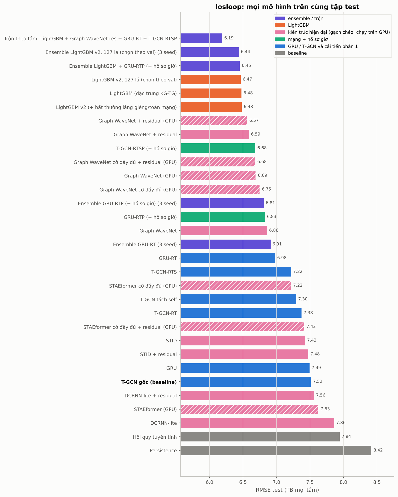

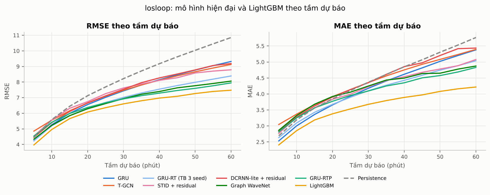

Kiểm định cặp so với mô hình tốt nhất của phần trước (ensemble GRU-RT), bootstrap khối 1 giờ + Diebold–Mariano:

| A | B | ΔRMSE (A−B) | KTC 95% | DM p | Kết luận |
|---|---|---|---|---|---|
| DCRNN-lite | ensemble GRU-RT | +0.952 | [+0.469; +1.490] | 0.0029 | B tốt hơn |
| DCRNN-lite + residual | ensemble GRU-RT | +0.650 | [+0.383; +0.966] | 0.0003 | B tốt hơn |
| GRU-RTP (+ hồ sơ giờ) (TB 3 seed) | ensemble GRU-RT | -0.101 | [-0.450; +0.215] | 0.5646 | không khác biệt |
| Graph WaveNet | ensemble GRU-RT | -0.050 | [-0.319; +0.167] | 0.6945 | không khác biệt |
| Graph WaveNet + residual (TB 3 seed) | ensemble GRU-RT | -0.448 | [-0.742; -0.210] | 0.0028 | A tốt hơn |
| LightGBM (đặc trưng KG-TG) (TB 3 seed) | ensemble GRU-RT | -0.461 | [-0.913; -0.114] | 0.0344 | A tốt hơn |
| LightGBM v2, 127 lá (chọn theo val) (TB 3 seed) | ensemble GRU-RT | -0.473 | [-0.909; -0.104] | 0.0337 | A tốt hơn |
| STID (TB 3 seed) | ensemble GRU-RT | +0.323 | [+0.093; +0.560] | 0.0163 | B tốt hơn |
| STID + residual (TB 3 seed) | ensemble GRU-RT | +0.385 | [+0.075; +0.730] | 0.0367 | B tốt hơn |
| T-GCN-RTSP (+ hồ sơ giờ) (TB 3 seed) | ensemble GRU-RT | -0.307 | [-0.643; -0.011] | 0.0793 | không khác biệt |
| Ensemble LightGBM v2, 127 lá (chọn theo val) (3 seed) | ensemble GRU-RT | -0.473 | [-0.920; -0.111] | 0.0337 | A tốt hơn |
| Ensemble LightGBM + GRU-RTP (+ hồ sơ giờ) | ensemble GRU-RT | -0.458 | [-0.848; -0.129] | 0.0255 | A tốt hơn |
| Trộn theo tầm (fit trên val) | ensemble GRU-RT | -0.720 | [-1.073; -0.441] | 0.0002 | A tốt hơn |
| GRU-RTP (3 seed) | GRU-RT (3 seed) | -0.101 | [-0.446; +0.204] | 0.5646 | không khác biệt |

Năm kết luận:

1. **Mô hình tốt nhất mới là trộn theo tầm LightGBM + Graph WaveNet-residual (+ GRU-RT): RMSE 6.19 / MAE 3.49** — giảm 10% RMSE so với ensemble GRU-RT (p = 0.0002), **18% RMSE và 20% MAE so với T-GCN gốc**, 17% / 16% so với GRU.
2. **LightGBM với đặc trưng thiết kế tay là mô hình đơn tốt nhất (6.47 / 3.60)**, cực kỳ ổn định giữa các seed (± 0.001), hơn ensemble GRU-RT có ý nghĩa (p = 0.03).
3. **Kiến trúc hiện đại: kết quả phân hóa.** **Graph WaveNet + residual (6.59 ± 0.12 / 3.67)** là mô hình đơn tốt thứ hai và là mạng nơ-ron tốt nhất (p = 0.003 so với ensemble GRU-RT) — nhưng *không có residual* thì chỉ 6.86 (không khác biệt có ý nghĩa). STID (7.43 ± 0.21) và DCRNN-lite (7.56–7.86) kém hơn ensemble GRU-RT có ý nghĩa.
4. **Đưa hồ sơ theo giờ vào mạng nơ-ron giúp ở tầm xa** (GRU-RTP 60 phút: 7.95 so với 8.39 của GRU-RT; T-GCN-RTSP 6.69) nhưng làm tệ đi ở 5 phút và **chưa có ý nghĩa thống kê** so với GRU-RT (p = 0.56 và 0.08).
5. **Chạy trên GPU (mục 11.8):** Graph WaveNet + residual tái lập đúng kết quả CPU (6.565 ± 0.052 so với 6.589 ± 0.117); **cỡ đầy đủ không tốt hơn cỡ gọn** (6.685 so với 6.565); STAEformer kém và rất không ổn định (cỡ đầy đủ 7.220 ± 0.431; cỡ gọn 7.628 ± 0.533 — còn kém T-GCN gốc). Trên 5 ngày dữ liệu, thêm tham số chỉ làm quá khớp nhanh hơn.

### 11.3 Phản biện — vì sao các mô hình SOTA không thắng ở đây

Các kiến trúc này được thiết kế và báo cáo trên METR-LA/PEMS-BAY (4–6 tháng). Los-loop chỉ có **5 ngày train** ≈ 1 400 cửa sổ:

- **Số tham số so với dữ liệu:** STID 117 nghìn, DCRNN-lite 67 nghìn, Graph WaveNet 166 nghìn so với 13–14 nghìn của GRU/T-GCN. Embedding thời gian của STID có 288 khung giờ × 32 chiều nhưng mỗi khung chỉ được thấy ~5 lần.
- **Dấu hiệu quá khớp đo được:** epoch tốt nhất của STID là 4–11, DCRNN-lite 25–27, GRU-RTP 6–11, T-GCN-RTSP 6–11 (GRU-RT: 19–37; GRU: 87–101), và độ lệch giữa các seed của STID lớn gấp 30 lần GRU (0.21 so với 0.006).
- **GPU xác nhận chẩn đoán này:** dùng cỡ của bài gốc (Graph WaveNet 301 nghìn, STAEformer 1.26 triệu tham số) không cải thiện mà còn tệ hơn trên Los-loop (Graph WaveNet + residual 6.565 → 6.685; STAEformer chọn epoch 2–15 và lệch giữa các seed 0.43–0.65, gấp 70–110 lần GRU), trong khi trên SZ-taxi (22 ngày) cỡ gọn và cỡ đầy đủ ngang nhau (4.428 so với 4.436). Giới hạn nằm ở *lượng dữ liệu*, không ở *sức tính* hay *kích thước mô hình*.
- **Ngoại lệ có tính hướng dẫn — Graph WaveNet + residual:** cũng quá khớp sớm (epoch tốt nhất 10–13) nhưng vẫn tốt: tích chập thời gian giãn nở + khuếch tán đồ thị hai chiều + đồ thị thích nghi cho biểu diễn đủ mạnh, còn residual (học Δ so với giá trị cuối — phát hiện ở mục 5.4) giữ cho mô hình không bao giờ tệ hơn persistence ở tầm ngắn. Bỏ residual: 6.86. Mẹo "đặt bài toán đúng" quan trọng ngang kiến trúc.
- **Kết luận đúng là "chưa kiểm chứng được trên dữ liệu đủ lớn", không phải "SOTA kém"** (mục 11.7 cho thấy STID và Graph WaveNet dẫn đầu trên SZ-taxi nhiều dữ liệu hơn): với METR-LA, Graph WaveNet/STAEformer giảm MAE 60 phút từ ~3.60 (DCRNN) xuống ~3.3–3.5. `tools/prepare_large_dataset.py` + `LOCAL_RUN.md` cho phép chạy lại toàn bộ trên các bộ đó.
- Ngược lại, LightGBM có **dừng sớm riêng cho từng tầm**: số cây tốt nhất khác hẳn nhau giữa các tầm (≈ 90 ở 5 phút, 200–550 ở tầm 15–45 phút, ≈ 50 ở 50–60 phút, seed 42), tức mỗi tầm tự chọn độ phức tạp phù hợp — còn mạng nơ-ron dùng một epoch chung cho cả 12 đầu ra. Cùng với việc cây quyết định khó học thuộc nhiễu hơn, đó đúng là thứ dữ liệu nhỏ cần.

### 11.4 Minh chứng — LightGBM dựa vào thông tin gì? (ảnh hưởng của thuộc tính)

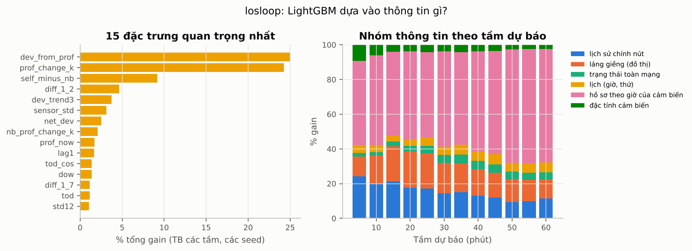

Tỉ trọng gain theo nhóm thông tin (trung bình 3 seed):

| Tầm | lịch sử chính nút | láng giềng (đồ thị) | trạng thái toàn mạng | lịch (giờ, thứ) | hồ sơ theo giờ của cảm biến | đặc tính cảm biến |
|---|---|---|---|---|---|---|
| 5 phút | 24.3% | 11.3% | 2.0% | 4.6% | 48.5% | 9.3% |
| 15 phút | 21.2% | 20.3% | 2.6% | 3.4% | 48.4% | 4.0% |
| 30 phút | 14.5% | 17.4% | 4.5% | 4.8% | 55.0% | 3.8% |
| 45 phút | 11.8% | 14.5% | 4.8% | 5.8% | 59.6% | 3.5% |
| 60 phút | 11.5% | 10.8% | 4.1% | 5.7% | 65.4% | 2.4% |

- **Hồ sơ theo giờ của chính cảm biến là nguồn thông tin số một** (~50% gain ở 5 phút, ~65% ở 60 phút): độ lệch hiện tại so với hồ sơ (`dev_from_prof`, "đang chậm/nhanh bất thường bao nhiêu") và thay đổi hồ sơ dự kiến tới t+k (`prof_change_k`, "sắp vào/ra giờ cao điểm"). Đây chính là thông tin mô hình học sâu thiếu: sin/cos của giờ cho biết *bây giờ là mấy giờ*, nhưng không cho biết *cảm biến này thường kẹt lúc mấy giờ*.
- **Láng giềng (đồ thị) đóng góp ~11–21%, đạt đỉnh ở tầm 15–25 phút** — khớp với kết quả mục 5 rằng đồ thị có ích nhất ở tầm trung/xa và khi biến động mạnh; ở 5 phút lịch sử của chính nút áp đảo.
- **Trạng thái toàn mạng và bất thường láng giềng (v2) thêm rất ít** (RMSE validation 5.352 → 5.348): thông tin đã nằm trong hồ sơ.
- **Siêu tham số gần như không quan trọng** — mọi cấu hình nằm trong 0.03 RMSE validation:

| Cấu hình LightGBM (seed 42) | RMSE val | RMSE test | MAE test |
|---|---|---|---|
| v1, 63 lá, lr 0.05 | 5.352 | 6.493 | 3.635 |
| v2, 63 lá, lr 0.05 | 5.348 | 6.481 | 3.613 |
| v2, 31 lá | 5.369 | 6.485 | 3.624 |
| v2, 127 lá | 5.341 | 6.466 | 3.593 |
| v2, lr 0.03 | 5.343 | 6.467 | 3.604 |

### 11.5 Giờ cao điểm: điểm yếu đã được khắc phục

**MAE – dự báo trước 15 phút**

| Mô hình | tất cả | cao điểm | ngoài cao điểm | kẹt xe (v<40) | biến động mạnh (Δ>10) |
|---|---|---|---|---|---|
| Persistence | **3.562** | **4.203** | 3.355 | **6.950** | 18.621 |
| T-GCN gốc (dự báo TB 3 seed) — *baseline* | 3.650 | 5.213 | 3.144 | 8.749 | 14.112 |
| GRU-RT (dự báo TB 3 seed) | **3.383** | **4.504** | **3.021** | **7.551** | 14.511 |
| GRU-RTP (dự báo TB 3 seed) | **3.551** | **4.751** | 3.163 | **8.222** | **13.148** |
| LightGBM (dự báo TB 3 seed) | **3.168** | **4.153** | **2.850** | **6.811** | **13.175** |
| Trộn theo tầm | **3.078** | **4.040** | **2.768** | **6.794** | **13.288** |

**MAE – dự báo trước 60 phút**

| Mô hình | tất cả | cao điểm | ngoài cao điểm | kẹt xe (v<40) | biến động mạnh (Δ>10) |
|---|---|---|---|---|---|
| Persistence | 5.765 | **7.441** | 5.223 | **13.580** | 24.286 |
| T-GCN gốc (dự báo TB 3 seed) — *baseline* | 5.377 | 8.590 | 4.339 | 16.202 | 16.512 |
| GRU-RT (dự báo TB 3 seed) | **4.972** | **8.018** | **3.987** | **13.259** | **14.896** |
| GRU-RTP (dự báo TB 3 seed) | **4.812** | **7.237** | **4.029** | **13.168** | **12.959** |
| LightGBM (dự báo TB 3 seed) | **4.209** | **5.994** | **3.632** | **10.420** | **12.832** |
| Trộn theo tầm | **4.107** | **5.876** | **3.536** | **10.681** | **12.581** |

*Số in đậm = tốt hơn T-GCN gốc (dòng baseline) ở cùng cột, so ở đúng số chữ số hiển thị; sai số thấp hơn là tốt hơn.*

- Lần đầu tiên có mô hình **thắng persistence trong giờ cao điểm ở 15 phút** (LightGBM 4.15, trộn 4.04 so với 4.20) và thắng rất xa ở 60 phút (trộn 5.88, LightGBM 5.99 so với 7.44 của persistence — giảm 19–21%; GRU-RT 8.02).
- Khi kẹt xe (v < 40 mph), MAE 60 phút giảm từ 13.3 (GRU-RT) xuống 10.4 (LightGBM): mô hình biết rằng cảm biến *đang trong khung giờ thường kẹt* nên không vội dự báo "sắp thông".
- **So với T-GCN gốc (dòng baseline)**: trong cao điểm, T-GCN gốc là mô hình kém nhất ở 15 phút (5.21; persistence 4.20); LightGBM giảm MAE 60 phút trong cao điểm từ 8.59 xuống 5.99 (−30%) và khi kẹt xe từ 16.2 xuống 10.4 (−36%). Mọi ô của LightGBM và bản trộn đều được in đậm.

### 11.6 Trộn theo tầm — vì sao thành viên "kém hơn" vẫn có ích

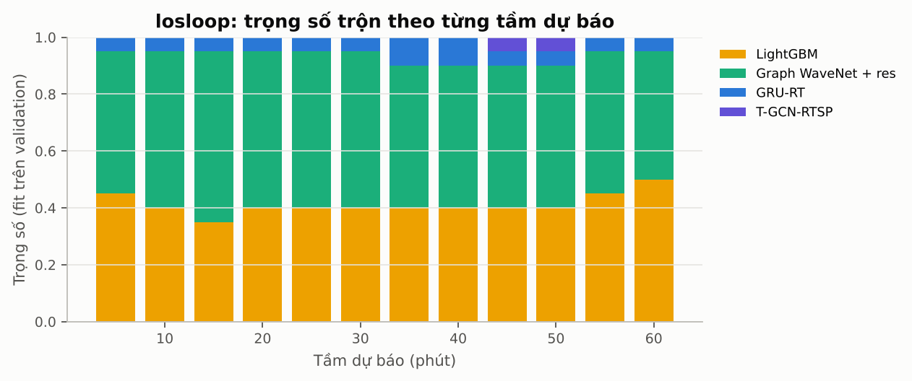

| Tầm | LightGBM | Graph WaveNet + res | GRU-RT | T-GCN-RTSP |
|---|---|---|---|---|
| 5 phút | 0.45 | 0.5 | 0.05 | 0.0 |
| 15 phút | 0.35 | 0.6 | 0.05 | 0.0 |
| 30 phút | 0.4 | 0.55 | 0.05 | 0.0 |
| 45 phút | 0.4 | 0.5 | 0.05 | 0.05 |
| 60 phút | 0.5 | 0.45 | 0.05 | 0.0 |

Trọng số tối ưu trên validation chia gần đều cho **LightGBM (~0.40) và Graph WaveNet-residual (~0.50)**, GRU-RT nhận ~0.05, T-GCN-RTSP gần 0. Hai mô hình đơn tốt nhất ở đây thuộc **hai họ rất khác nhau** — cây quyết định trên đặc trưng thiết kế tay và mạng nơ-ron đồ thị học biểu diễn trực tiếp — nên sai số của chúng ít tương quan và trộn lại giảm thêm 4–6% RMSE so với từng mô hình.

Bản trộn trước khi có Graph WaveNet (LightGBM + GRU-RT + GRU-RTP + T-GCN-RTSP) cho 6.29 / 3.58, với LightGBM 0.55 → 0.75 (tăng theo tầm) và GRU-RT 0.35 → 0.25; khi đó **GRU-RTP và T-GCN-RTSP — dù tốt hơn GRU-RT khi đứng một mình — nhận trọng số 0**, vì chúng dùng cùng thông tin hồ sơ như LightGBM nên sai số trùng nhau. Ensemble cần thành viên *đa dạng*, không cần thành viên mạnh nhất; vì vậy ensemble chia đều LightGBM + GRU-RTP (6.45) kém hơn trộn có trọng số.

So với bài báo (cách tính gộp của tác giả): mô hình trộn đạt "15 phút" RMSE 4.74 / MAE 2.75 / Accuracy 0.919 / R² 0.883 và "60 phút" 6.19 / 3.49 / 0.895 / 0.800 — so với T-GCN trong bài báo 5.13 / 3.18 / 0.913 / 0.863 và 7.27 / 4.60 / 0.876 / 0.728 (giảm 8% và 15% RMSE, 13% và 24% MAE), dù giao thức chặt hơn.

### 11.7 SZ-taxi

Cùng các hướng trên SZ-taxi (22 ngày train, mục tiêu ≠ 0; Graph WaveNet và STAEformer chỉ chạy trên GPU, DCRNN không chạy):

| Mô hình | nhóm | seed | tham số | RMSE val | RMSE test | MAE test | 15 phút | 60 phút | phút/run |
|---|---|---|---|---|---|---|---|---|---|
| Trộn theo tầm: LightGBM + STID-res + GRU-RTP + GRU | ensemble | 3 | — | — | **4.402** | **3.106** | **4.35** / **3.06** | **4.44** / **3.14** | — |
| Graph WaveNet (GPU) | hiện đại (GPU) | 3 | 162,548 | — | **4.428** ± 0.011 | **3.131** ± 0.008 | — | — | — |
| Graph WaveNet cỡ đầy đủ (GPU) | hiện đại (GPU) | 3 | 295,924 | — | **4.436** ± 0.013 | **3.133** ± 0.007 | — | — | — |
| STAEformer (GPU) | hiện đại (GPU) | 3 | 253,140 | — | **4.443** ± 0.016 | **3.139** ± 0.009 | — | — | — |
| STID | hiện đại | 3 | 108,292 | **3.829** | **4.445** ± 0.009 | **3.140** ± 0.005 | **4.39** / **3.09** | **4.49** / **3.18** | 4 |
| STAEformer cỡ đầy đủ (GPU) | hiện đại (GPU) | 3 | 1,190,764 | — | **4.445** ± 0.012 | **3.141** ± 0.005 | — | — | — |
| STID + residual | hiện đại | 3 | 108,292 | **3.829** | **4.449** ± 0.007 | **3.143** ± 0.009 | **4.38** / **3.09** | **4.50** / **3.18** | 4 |
| STAEformer cỡ đầy đủ + residual (GPU) | hiện đại (GPU) | 3 | 1,190,764 | — | **4.460** ± 0.011 | **3.152** ± 0.007 | — | — | — |
| Graph WaveNet cỡ đầy đủ + residual (GPU) | hiện đại (GPU) | 3 | 295,924 | — | **4.460** ± 0.003 | **3.143** ± 0.002 | — | — | — |
| Graph WaveNet + residual (GPU) | hiện đại (GPU) | 3 | 162,548 | — | **4.464** ± 0.015 | **3.146** ± 0.011 | — | — | — |
| Ensemble LightGBM v2, 127 lá (chọn theo val) (3 seed) | ensemble | 3 | — | — | **4.484** | **3.163** | **4.44** / **3.12** | **4.51** / **3.19** | — |
| Ensemble LightGBM + GRU-RTP (+ hồ sơ giờ) | ensemble | 3 | — | — | **4.486** | **3.174** | **4.44** / **3.13** | **4.52** / **3.21** | — |
| LightGBM v2, 127 lá (chọn theo val) | khai phá dữ liệu | 3 | — | **3.853** | **4.494** ± 0.002 | **3.170** ± 0.001 | **4.45** / **3.13** | **4.53** / **3.20** | 3 |
| LightGBM (đặc trưng KG-TG) | khai phá dữ liệu | 3 | — | **3.899** | **4.523** ± 0.002 | **3.199** ± 0.001 | **4.46** / **3.14** | **4.57** / **3.24** | 4 |
| Ensemble GRU-RTP (+ hồ sơ giờ) (3 seed) | ensemble | 3 | — | — | **4.567** | **3.250** | **4.49** / **3.18** | **4.63** / **3.31** | — |
| GRU-RTP (+ hồ sơ giờ) | hồ sơ giờ | 3 | 14,100 | **3.979** | **4.584** ± 0.018 | **3.265** ± 0.016 | **4.50** / **3.19** | **4.64** / **3.32** | 6 |
| GRU-RT | phần 1 | 1 | 13,892 | **3.977** | **4.615** | **3.265** | **4.53** / **3.19** | **4.69** / **3.33** | 17 |
| GRU | paper | 3 | 13,124 | **3.970** | **4.619** ± 0.001 | **3.269** ± 0.002 | **4.52** / **3.19** | **4.70** / **3.34** | 10 |
| Hồi quy tuyến tính | baseline | 1 | — | — | **4.661** | 3.348 | **4.55** / **3.25** | 4.76 / 3.43 | — |
| T-GCN gốc — *baseline* | paper | 3 | 12,932 | 4.019 | 4.694 ± 0.004 | 3.346 ± 0.004 | 4.62 / 3.29 | 4.76 / 3.40 | 30 |
| T-GCN-RT | phần 1 | 1 | 13,700 | 4.583 | 5.280 | 3.780 | 5.16 / 3.68 | 5.37 / 3.85 | 29 |
| Persistence | baseline | 1 | — | — | 6.012 | 4.262 | 5.84 / 4.14 | 6.15 / 4.36 | — |

*Mọi sai số tính trên mục tiêu ≠ 0; RMSE / MAE trung bình 4 tầm; "15 phút", "60 phút" = tại đúng bước đó. Dòng "(GPU)": chạy trên GPU máy của bạn, 3 seed (42, 123, 2026), cùng giao thức; tệp kết quả không có RMSE validation và thời gian, cũng không có sai số từng bước trên mục tiêu ≠ 0 (—).*

*Số in đậm = tốt hơn T-GCN gốc (dòng baseline) ở cùng cột, so ở đúng số chữ số hiển thị; sai số thấp hơn là tốt hơn.*

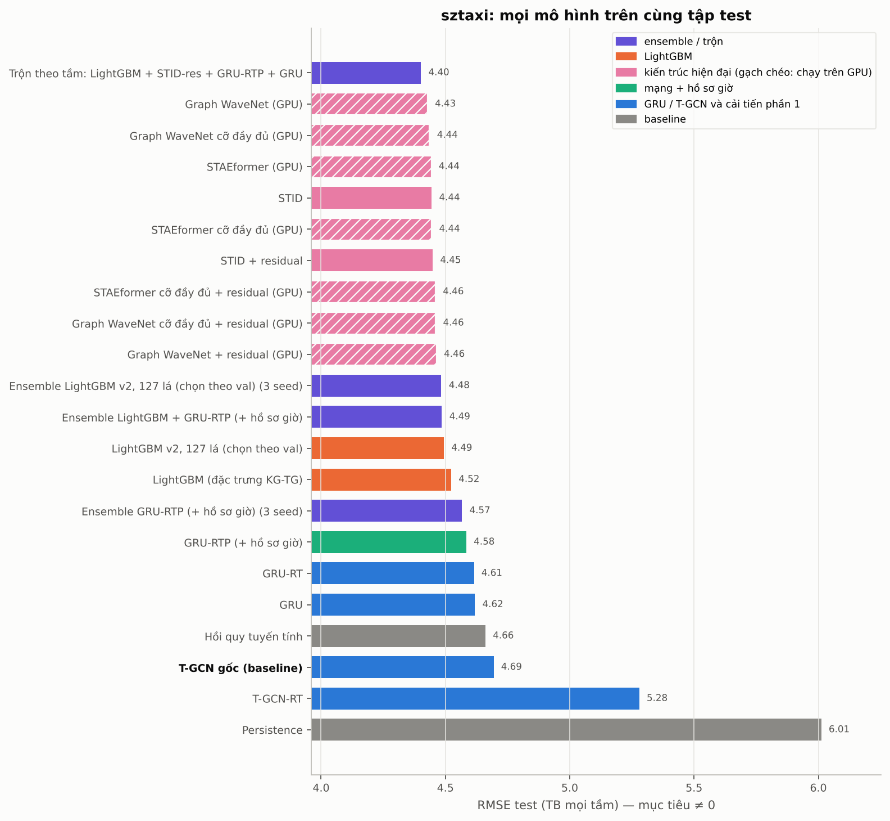

Trên SZ-taxi, bức tranh **đảo ngược** so với Los-loop — và chính sự đảo ngược đó là minh chứng:

- **Các mô hình tự học hồ sơ theo giờ dẫn đầu:** Graph WaveNet chạy GPU (4.428 ± 0.011 / 3.131), STAEformer GPU (4.443 ± 0.016) và STID (4.445 ± 0.009 / 3.140) ngang nhau trong phạm vi ~2 độ lệch chuẩn giữa các seed, đều hơn LightGBM v2 (4.494) và GRU (4.619). Với STID, khác biệt so với GRU-RT (trên SZ-taxi chỉ có 1 seed) có ý nghĩa (p < 10⁻⁴); các run GPU chưa có tệp dự báo nên chưa kiểm định cặp được. Trộn theo tầm (STID 0.75–0.80, LightGBM 0.10–0.20) đạt **4.402 / 3.106**, giảm 4.7% RMSE và 5.0% MAE so với GRU, **6.2% / 7.2% so với T-GCN gốc**.
- **Vì sao STID thắng ở đây mà thua ở Los-loop?** Embedding "danh tính cảm biến" và "khung giờ" của STID thực chất **tự học hồ sơ theo giờ của từng cảm biến** — đúng tri thức mà LightGBM nhận qua đặc trưng thiết kế tay. Với SZ-taxi mỗi khung giờ được thấy ~22 lần trong train, đủ để học; với Los-loop chỉ ~5 lần, nên STID quá khớp. Cùng một ý tưởng, hai kết luận ngược nhau — phụ thuộc vào lượng dữ liệu.
- LightGBM v2 (thêm bất thường láng giềng/toàn mạng) cải thiện rõ trên SZ-taxi (4.494 so với 4.523 của v1), khác với Los-loop: đặc trưng trạng thái toàn mạng hữu ích hơn trên chuỗi nhiễu, nơi trung bình hóa nhiều cảm biến lọc được nhiễu.
- Residual tiếp tục không giúp trên dữ liệu nhiễu (STID + residual 4.449 ≈ STID 4.445; Graph WaveNet + residual 4.464 so với 4.428 trên GPU), nhất quán với mục 10 — ngược với Los-loop, nơi residual giúp chính Graph WaveNet (6.693 → 6.565 trên GPU). Trên chuỗi mượt, neo dự báo vào giá trị cuối là neo vào thông tin; trên chuỗi nhiễu là neo vào nhiễu.

### 11.8 Các lần chạy trên GPU: kiểm tra số liệu và kết quả

**Đã chạy gì.** 7 cấu hình (Graph WaveNet và STAEformer; cỡ gọn và cỡ đầy đủ theo bài gốc; có/không residual) × 3 seed (42, 123, 2026) × 2 bộ dữ liệu = 42 run, cùng giao thức nghiêm ngặt (70/10/20, thống kê chỉ từ train, dừng sớm theo validation; `python run_suite.py --dataset … --groups modern_gpu`). Các bảng bạn đẩy lên (sai số từng run; tóm tắt cho SZ-taxi) được giữ nguyên trong `reports/external/` để không script nào ghi đè, và `analysis/compare_models.py` gộp chúng với các run CPU vào `reports/tables/all_runs_*.csv` (106 run Los-loop, 62 run SZ-taxi).

**Kiểm tra số liệu** (`python analysis/gpu_results.py`):

| Bộ dữ liệu | Kiểm tra | Kết quả |
|---|---|---|
| SZ-taxi | tệp tóm tắt của bạn = tính lại từ 21 run (TB và độ lệch chuẩn ddof = 1, 4 chỉ số) | 7/7 cấu hình khớp tuyệt đối |
| Los-loop | RMSE tăng theo tầm dự báo ở mọi run (dung sai 0.05) | 21/21 run đạt |
| Los-loop | Graph WaveNet (gọn): CPU (1 seed) vs GPU (3 seed) | CPU 6.860; GPU 6.693 ± 0.061 |
| Los-loop | Graph WaveNet + res (gọn): CPU (3 seed) vs GPU (3 seed) | CPU 6.589 ± 0.117; GPU 6.565 ± 0.052 |
| SZ-taxi | RMSE tăng theo tầm dự báo ở mọi run (dung sai 0.05) | 21/21 run đạt |

- Tệp tóm tắt của bạn cho SZ-taxi khớp tuyệt đối (sai khác < 10⁻¹²) với giá trị tính lại từ 21 run — cả trung bình lẫn độ lệch chuẩn (ddof = 1), cho RMSE/MAE trên mọi mục tiêu và trên mục tiêu ≠ 0. Với Los-loop, bảng tóm tắt được dựng từ 21 run theo đúng cách đó.
- Ở mọi run, sai số tăng theo tầm dự báo — không có dấu hiệu lệch cột hay ghi nhầm tầm.
- **Graph WaveNet + residual tái lập giữa hai máy:** CPU 6.589 ± 0.117 và GPU 6.565 ± 0.052 (chênh 0.02, nhỏ hơn độ lệch chuẩn). Với Graph WaveNet không residual, run CPU duy nhất (seed 42: 6.860) cao hơn cả 3 run GPU (6.62–6.74) dù cùng seed và cùng chọn epoch 10: cùng một seed không cho cùng quỹ đạo huấn luyện trên phần cứng khác (phép cộng dấu phẩy động trên GPU không tất định), nên chênh lệch giữa hai máy cũng là một phần của độ biến thiên — thêm một lý do để mọi kết luận ở đây dựa trên 3 seed.

**Chỉ số kiểu bài báo cho các run GPU.** Bảng kết quả GPU chỉ có sai số tại từng bước, không có tệp dự báo. Vì mọi mô hình dùng chung các cửa sổ test (cùng số mục tiêu ở mỗi bước), sai số gộp các bước 1…k suy ra được **chính xác**: RMSE₁..ₖ = √(TB_j RMSE_j²), MAE₁..ₖ = TB_j MAE_j, Accuracy = 1 − √(n·RMSE₁..ₖ²) / ‖Y₁..ₖ‖ và R² = 1 − n·RMSE₁..ₖ² / SST(Y₁..ₖ), với Y là các mục tiêu test chung (n phần tử). Công thức được kiểm chứng trên các run CPU có cả hai loại số (khớp tới mọi chữ số in ra) và trên chính 42 run GPU (giá trị suy ra khi k = toàn bộ tầm trùng với RMSE, MAE, R² tổng mà run ghi lại: sai khác ≤ 3·10⁻¹⁵ và ≤ 6·10⁻¹¹). Nhờ vậy các dòng "(GPU)" có mặt trong bảng tổng hợp ở đầu báo cáo (`reports/tables/modern_gpu_cumulative_*.csv`).

**Kết quả — Los-loop:**

| Cấu hình | tham số | epoch chọn | RMSE | MAE | 15 phút | 60 phút | Δ RMSE |
|---|---|---|---|---|---|---|---|
| T-GCN gốc (tái lập, CPU) — *baseline* | 13,452 | — | 7.516 ± 0.031 | 4.371 ± 0.037 | 6.16 / 3.67 | 9.13 / 5.39 | — |
| Graph WaveNet (gọn) | 165,624 | 9–13 | **6.693** ± 0.061 | **3.904** ± 0.051 | **5.65** / **3.35** | **8.03** / **4.71** | -11.0% |
| Graph WaveNet + res (gọn) | 165,624 | 7–10 | **6.565** ± 0.052 | **3.741** ± 0.041 | **5.58** / **3.23** | **7.78** / **4.49** | -12.7% |
| Graph WaveNet (đầy đủ) | 301,048 | 9–15 | **6.752** ± 0.165 | **3.894** ± 0.138 | **5.68** / **3.36** | **8.02** / **4.64** | -10.2% |
| Graph WaveNet + res (đầy đủ) | 301,048 | 11–21 | **6.685** ± 0.129 | **3.736** ± 0.062 | **5.63** / **3.22** | **7.93** / **4.46** | -11.1% |
| STAEformer (gọn) | 283,484 | 5–14 | 7.628 ± 0.533 | **4.261** ± 0.365 | 6.44 / 3.73 | **8.95** / **4.91** | +1.5% |
| STAEformer (đầy đủ) | 1,258,932 | 7–12 | **7.220** ± 0.431 | **4.051** ± 0.173 | 6.20 / **3.55** | **8.45** / **4.74** | -3.9% |
| STAEformer + res (đầy đủ) | 1,258,932 | 2–15 | **7.418** ± 0.654 | **4.190** ± 0.297 | **6.10** / **3.53** | **8.89** / **5.12** | -1.3% |

*RMSE, MAE: trung bình 12 tầm ± độ lệch chuẩn 3 seed; "15 phút", "60 phút" = RMSE / MAE tại đúng bước đó.*

*Số in đậm = tốt hơn T-GCN gốc tái lập, TB 3 seed (dòng baseline) ở cùng cột, so ở đúng số chữ số hiển thị; sai số thấp hơn là tốt hơn.*

**Kết quả — SZ-taxi:**

| Cấu hình | tham số | epoch chọn | RMSE ≠0 | MAE ≠0 | RMSE | MAE | 15 phút | 60 phút | Δ RMSE |
|---|---|---|---|---|---|---|---|---|---|
| T-GCN gốc (tái lập, CPU) — *baseline* | 12,932 | — | 4.694 ± 0.004 | 3.346 ± 0.004 | 4.225 ± 0.005 | 2.825 ± 0.005 | 4.16 / 2.78 | 4.29 / 2.86 | — |
| Graph WaveNet (gọn) | 162,548 | 33–47 | **4.428** ± 0.011 | **3.131** ± 0.008 | **4.019** ± 0.006 | **2.680** ± 0.007 | **3.97** / **2.64** | **4.05** / **2.70** | -5.7% |
| Graph WaveNet + res (gọn) | 162,548 | 44–71 | **4.464** ± 0.015 | **3.146** ± 0.011 | **4.034** ± 0.017 | **2.669** ± 0.013 | **3.98** / **2.63** | **4.08** / **2.70** | -4.9% |
| Graph WaveNet (đầy đủ) | 295,924 | 26–31 | **4.436** ± 0.013 | **3.133** ± 0.007 | **4.022** ± 0.010 | **2.677** ± 0.003 | **3.97** / **2.64** | **4.06** / **2.71** | -5.5% |
| Graph WaveNet + res (đầy đủ) | 295,924 | 27–35 | **4.460** ± 0.003 | **3.143** ± 0.002 | **4.024** ± 0.009 | **2.650** ± 0.018 | **3.97** / **2.61** | **4.07** / **2.69** | -5.0% |
| STAEformer (gọn) | 253,140 | 19–25 | **4.443** ± 0.016 | **3.139** ± 0.009 | **4.029** ± 0.018 | **2.689** ± 0.030 | **3.98** / **2.66** | **4.07** / **2.72** | -5.3% |
| STAEformer (đầy đủ) | 1,190,764 | 18–25 | **4.445** ± 0.012 | **3.141** ± 0.005 | **4.031** ± 0.008 | **2.691** ± 0.021 | **3.99** / **2.66** | **4.07** / **2.71** | -5.3% |
| STAEformer + res (đầy đủ) | 1,190,764 | 11–20 | **4.460** ± 0.011 | **3.152** ± 0.007 | **4.034** ± 0.009 | **2.686** ± 0.008 | **3.98** / **2.65** | **4.08** / **2.72** | -5.0% |

*RMSE, MAE: trung bình 4 tầm (cột "≠0": chỉ mục tiêu khác 0, tiêu chí chính của SZ-taxi; hai cột kế: mọi mục tiêu); "15 phút", "60 phút" = RMSE / MAE tại đúng bước đó, mọi mục tiêu; Δ RMSE trên mục tiêu ≠ 0.*

*Số in đậm = tốt hơn T-GCN gốc tái lập, TB 3 seed (dòng baseline) ở cùng cột, so ở đúng số chữ số hiển thị; sai số thấp hơn là tốt hơn.*

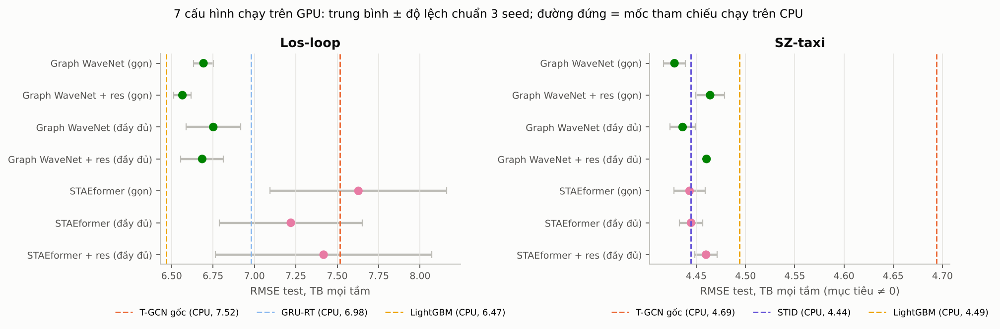

Phân tích:

1. **Los-loop: cỡ đầy đủ không giúp, STAEformer quá khớp.** Graph WaveNet cỡ đầy đủ (301 nghìn tham số) kém cỡ gọn cả khi không residual (6.752 so với 6.693) lẫn có residual (6.685 so với 6.565). STAEformer là kiến trúc kém nhất và kém ổn định nhất: cỡ gọn 7.628 ± 0.533 — **là cấu hình GPU duy nhất có RMSE kém T-GCN gốc (+1.5%)** — cỡ đầy đủ 7.220 ± 0.431; epoch tốt nhất chỉ 2–15, và seed tốt nhất (6.79–7.03) cách seed tệ nhất (7.65–8.10) 0.9–1.3 mph. Với ~1 400 cửa sổ train, attention theo thời gian và theo nút có quá nhiều bậc tự do (mục 11.3).
2. **Residual giúp ở Los-loop, hại ở SZ-taxi** — cùng kiến trúc, cùng máy: Graph WaveNet 6.693 → 6.565 trên Los-loop nhưng 4.428 → 4.464 trên SZ-taxi, đúng như kết luận về tính chất dữ liệu ở mục 10.
3. **SZ-taxi: kích thước gần như không quan trọng** — cả 7 cấu hình nằm trong 0.04 RMSE (4.428–4.464, mục tiêu ≠ 0) và ngang STID (4.445): với thông tin đầu vào hiện có, bộ dữ liệu nhiễu này có "trần" khoảng 4.40–4.45. Graph WaveNet cỡ gọn là mô hình đơn tốt nhất về số (4.428, −5.7% so với T-GCN gốc), nhưng chỉ hơn STID 0.017 (< 2 độ lệch chuẩn giữa các seed) nên chưa thể kết luận khi chưa có kiểm định cặp.
4. **Hạn chế:** chỉ có bảng sai số, chưa có tệp dự báo, nên chưa làm được kiểm định Diebold–Mariano, phân tích giờ cao điểm, conformal hay trộn theo tầm với các mô hình GPU. Nếu chép các thư mục `results/<dataset>/modern_gpu/<cấu hình>/seed_*/` (cần `metrics.json`, `history.csv`, `config.json`, `test_predictions.npz` và `best.pt` hoặc `val_predictions.npz`) vào repo (`git add -f`, vì `results/` bị bỏ qua), `analysis/modern_models.py` tự đưa chúng vào bảng và kiểm định (dưới tên `gpu_<cấu hình>`), còn `analysis/blend.py --members lgbm_best gpu_gwnet_res ...` đưa chúng vào bản trộn.

### 11.9 Mô hình cuối cùng mới và cách đọc lên để dự báo

Theo validation, **LightGBM (v2, 127 lá) là mô hình đơn tốt nhất**, **Graph WaveNet + residual là mạng nơ-ron tốt nhất**, và **trộn theo tầm hai mô hình này (+ GRU-RT với trọng số nhỏ) là dự báo cuối cùng** cho Los-loop. Các tệp trong `models/`: `losloop_lgbm/` (LightGBM), `losloop_gwnet_res.pt` (Graph WaveNet, seed tốt nhất theo validation), `losloop_gru_res_time_seed*.pt` (GRU-RT); SZ-taxi: `sztaxi_lgbm/`, `sztaxi_stid.pt` (Graph WaveNet chạy GPU nhỉnh hơn STID nhưng chưa có checkpoint trong repo, nên bản trộn SZ-taxi vẫn là STID-res + LightGBM). Mô hình LightGBM là một thư mục:

| Tệp | Nội dung |
|---|---|
| `model/h01.txt … h12.txt` | 12 mô hình cây tăng cường (một cho mỗi tầm 5…60 phút), định dạng văn bản của LightGBM |
| `model/stats.npz` | trung bình/độ lệch chuẩn train của từng cảm biến, ma trận kề chuẩn hóa, **hồ sơ theo giờ** [288 × 207], danh sách cảm biến, bước thời gian, phiên bản đặc trưng |

Đọc lên và dự báo (cùng lệnh `predict.py`, truyền thư mục thay vì tệp `.pt`):

```bash
python predict.py --checkpoint models/losloop_lgbm --input data/losloop/speed.csv --end-time "2012-03-07 07:30" --compare --sensors 4
```

Quy trình bên trong: đọc 12 mốc gần nhất → chuẩn hóa bằng thống kê train → dựng ~50 đặc trưng (độ trễ, láng giềng qua Â, giờ/thứ, độ lệch so với hồ sơ) → mỗi mô hình h_k dự báo Δ_k → ŷ_{t+k} = x_t + Δ_k → đổi về mph, cắt về ≥ 0. Kết quả dựng lại từ CSV khớp đúng dự báo đã lưu trên test (sai khác ~1e-5 mph).

```
LightGBM (12 boosters, one per horizon, features v2) | input ends 2012-03-07 07:30:00
                    forecast                          actual                                 
                      773869 767541 767542 717447     773869     767541     767542     717447
target_time                                                                                  
2012-03-07 07:35:00     67.6   64.9   23.9   51.9  67.625000  65.750000  18.125000  51.875000
2012-03-07 07:40:00     67.6   64.7   25.3   52.4  67.444444  66.111111  20.000000  48.333333
2012-03-07 07:45:00     67.6   65.5   22.2   53.2  68.000000  67.250000  18.125000  46.500000
2012-03-07 07:50:00     67.5   65.3   23.1   53.3  68.333333  63.888889  20.000000  50.222222
2012-03-07 07:55:00     67.2   66.1   22.8   53.1  67.875000  67.750000  24.750000  50.000000
2012-03-07 08:00:00     67.2   65.8   24.5   53.7  68.777778  60.666667  26.666667  51.555556
2012-03-07 08:05:00     66.9   65.5   24.3   53.8  66.500000  65.750000  20.500000  51.875000
2012-03-07 08:10:00     66.7   65.7   23.9   54.0  68.500000  65.000000  18.375000  45.625000
2012-03-07 08:15:00     66.7   65.6   23.2   54.3  66.555556  66.222222  21.777778  51.333333
2012-03-07 08:20:00     66.4   65.1   27.3   54.2  68.000000  64.875000  21.500000  54.625000
2012-03-07 08:25:00     66.4   65.0   26.2   54.0  67.333333  66.333333  21.833333  53.500000
2012-03-07 08:30:00     66.3   65.1   26.7   54.0  67.222222  67.000000  22.555556  53.111111
```

So với ví dụ cùng thời điểm ở mục 6.2: với cảm biến đang kẹt 767542 (thực tế 18–23 mph), ensemble GRU-RT dự báo "hồi phục" dần lên 38.5 mph sau 1 giờ, còn **LightGBM giữ ở 22–27 mph** — mô hình biết cảm biến này đang ở trong khung giờ thường kẹt (đặc trưng `dev_from_prof`, `prof_change_k`), nên không kéo dự báo về mức thông thoáng. Đây là minh chứng cụ thể cho việc giảm MAE khi kẹt xe ở mục 11.5.

Graph WaveNet được nạp đúng như GRU/T-GCN (`predict.py --checkpoint models/losloop_gwnet_res.pt ...`, checkpoint chứa kiến trúc, trọng số, ma trận chuyển P_f, P_b và thống kê chuẩn hóa). Trộn theo tầm không cần mã riêng: lấy dự báo của LightGBM, Graph WaveNet và GRU-RT rồi cộng có trọng số theo bảng ở mục 11.6 (trọng số lưu trong `results/losloop/ensemble/blend/metrics.json`).


## 12. Hạn chế và hướng phát triển

**Hạn chế của nghiên cứu này**

- Los-loop chỉ 7 ngày: tập test ~1.4 ngày; kết luận về giờ cao điểm dựa trên 3 đợt cao điểm. Cần lặp lại trên METR-LA đầy đủ (4 tháng, cùng 207 cảm biến) hoặc PEMS-BAY (bộ dữ liệu trong danh sách bài báo tham khảo).
- Huấn luyện trên CPU: ≤ 120 epoch với lịch học cosine thay vì 3000 epoch như tác giả; tinh chỉnh và một số biến thể chỉ có 1 seed.
- Các cấu hình lớn đã chạy trên GPU (mục 11.8) nhưng mới có bảng sai số, chưa có tệp dự báo, nên chưa kiểm định cặp, phân tích giờ cao điểm hay trộn được với chúng; trên SZ-taxi, ưu thế của Graph WaveNet (GPU) so với STID còn nằm trong độ biến thiên giữa các seed.
- Không có dữ liệu sự kiện (tai nạn, thời tiết) — nguyên nhân của phần lớn sai số lớn trong giờ cao điểm.

**Hướng phát triển (theo thứ tự lợi ích kỳ vọng / chi phí)**

1. **Đưa vào sử dụng ngay:** trộn LightGBM + Graph WaveNet-residual theo tầm (mục 11), kèm bước kiểm tra/điền giá trị thiếu ở đầu vào và cắt dự báo về [0, v_max].
2. **Chạy các kiến trúc hiện đại trên dữ liệu đủ lớn** (METR-LA, PEMS-BAY — `LOCAL_RUN.md`). Cỡ đầy đủ trên GPU đã được thử trên Los-loop/SZ-taxi (mục 11.8) và không cải thiện — giới hạn là dữ liệu, nên bước tiếp theo là dữ liệu 4–6 tháng, không phải mô hình lớn hơn. Đồng thời đẩy tệp dự báo của các run GPU để đưa Graph WaveNet (GPU) vào kiểm định và bản trộn của SZ-taxi.
3. **Đưa hồ sơ theo giờ vào mạng nơ-ron một cách có điều chuẩn**: hiện GRU-RTP/T-GCN-RTSP quá khớp sau 6–11 epoch; nên thử dropout/weight decay mạnh hơn, hoặc dừng sớm riêng cho từng tầm như LightGBM.
4. **Dự báo phân vị / conformal theo giờ** để khoảng dự báo đạt độ phủ đúng cả trong giờ cao điểm.
5. **Điền giá trị thiếu ở đầu vào** (SZ-taxi: số 0 = không có taxi) bằng trung bình láng giềng hoặc hồ sơ theo giờ, thay vì chỉ bỏ qua chúng trong loss (đã thử, không cải thiện).
6. **Dữ liệu ngoài**: lịch sự kiện, tai nạn, thời tiết — nguồn chính của sai số lớn còn lại trong giờ cao điểm.

## 13. Kết luận

Chúng tôi đã cài đặt lại và chạy GRU, GCN, T-GCN cùng 4 baseline cổ điển trên Los-loop và SZ-taxi với cùng dữ liệu, cùng cách chia và 3 seed (≈ 100 run kể cả phần nâng cao). **GRU tái lập đúng bài báo; T-GCN thì không vượt được GRU** một cách có ý nghĩa trên cả hai bộ dữ liệu — chính Bảng 1 của bài báo cũng cho thấy MAE của GRU tốt hơn. Nguyên nhân cơ chế là phép chuẩn hóa D^(-1/2)(A+I)D^(-1/2) chỉ để lại ~30% trọng số cho tín hiệu của chính nút, làm hỏng dự báo tầm ngắn; bằng chứng đến từ bốn hướng độc lập (thí nghiệm liều–đáp ứng với self-loop, permutation importance, gradient saliency và việc sửa đúng chỗ đó — tách self/láng giềng — làm T-GCN vượt GRU có ý nghĩa thống kê). Con số của bài báo còn được "làm đẹp" bởi việc chọn epoch theo test, cách gộp tầm dự báo và baseline yếu (thiếu persistence; HA trên SZ-taxi yếu gần gấp đôi một trung bình trượt) — trong khi persistence lại là mô hình tốt nhất trong giờ cao điểm.

Cải tiến hiệu quả nhất trên Los-loop không nằm ở đồ thị mà ở **cách đặt bài toán**: học phần thay đổi so với giá trị cuối (residual) và cho mô hình biết giờ trong ngày; ensemble 3 seed của GRU-RT giảm RMSE 7.8% so với GRU và 8.0% so với T-GCN (có ý nghĩa thống kê), vượt mọi con số trong bài báo dù dùng giao thức chặt hơn. Nhưng cải tiến phụ thuộc dữ liệu: trên SZ-taxi (nhiễu, nhiều giá trị thiếu) residual không giúp, và mọi mô hình chỉ hơn trung bình trượt vài phần trăm. Đồ thị có giá trị thật — ở tầm xa, khi tốc độ biến động mạnh, khi dữ liệu nhiễu — nhưng chỉ khi được thiết kế để không xóa mờ thông tin riêng của từng nút.

Phần cải tiến nâng cao (mục 11) củng cố kết luận đó theo hướng khai phá dữ liệu: **thông tin đúng quan trọng hơn kiến trúc phức tạp**. Một mô hình LightGBM với đặc trưng thiết kế từ hiểu biết về giao thông — đặc biệt là hồ sơ tốc độ theo khung giờ của từng cảm biến — là mô hình đơn tốt nhất trên dữ liệu nhỏ này và khắc phục điểm yếu giờ cao điểm. Trong các kiến trúc hiện đại, chỉ Graph WaveNet *kết hợp với residual* tiến sát nó; trộn hai họ mô hình này theo tầm (trọng số học trên validation) cho sai số thấp hơn 18% (RMSE) và 20% (MAE) so với T-GCN gốc, và tốt hơn con số T-GCN trong bài báo ở cả 16/16 ô của Bảng 1 (RMSE "60 phút" −15%, MAE −24%). Chạy lại trên GPU với cỡ đầy đủ của bài gốc xác nhận rằng giới hạn là dữ liệu chứ không phải sức tính: thêm tham số không giúp khi chỉ có 5 ngày train (STAEformer cỡ đầy đủ, 1.26 triệu tham số, kém Graph WaveNet cỡ gọn; STAEformer cỡ gọn còn kém cả T-GCN gốc). Trên SZ-taxi nhiều dữ liệu hơn, STID và Graph WaveNet — các mô hình tự học "hồ sơ" qua embedding — lại dẫn đầu (−5 đến −6% RMSE so với T-GCN gốc): cùng một tri thức, được học tự động khi đủ dữ liệu hoặc được đưa vào bằng tay khi thiếu dữ liệu.

## Phụ lục A. Cách chạy lại toàn bộ

```bash
pip install -r requirements.txt
python download_data.py --dataset losloop
python download_data.py --dataset sztaxi
python -m unittest discover -s tests -v                   # 8 test
python baselines.py --dataset losloop                     # naive, HA, linear
python baselines.py --dataset sztaxi
python run_suite.py --spec losloop:main losloop:improve losloop:variants losloop:tuning --jobs 4
python run_suite.py --spec losloop:paper sztaxi:paper sztaxi:main sztaxi:improve --jobs 4
python analysis/eda.py
python analysis/compare_models.py --dataset losloop      # bảng chính, ensemble, so sánh bài báo
python analysis/peak_hours.py --dataset losloop
python analysis/tuning_ablation.py --dataset losloop
python analysis/feature_importance.py --dataset losloop
python analysis/explain.py --dataset losloop
python analysis/reliability.py --dataset losloop
python tools/export_models.py                             # models/*.pt (chọn seed theo validation)
python tools/md2docx.py reports/BAO_CAO_TGCN.md reports/BAO_CAO_TGCN.docx
```

Thời gian: ≈ 15–45 phút/run trên 1 nhân CPU; toàn bộ ≈ 60 run ≈ 7–8 giờ với 4 nhân. Mọi run ghi `config.json`, `history.csv` (kèm RMSE test theo epoch chỉ để theo dõi), `metrics.json` (per-step, cumulative, Accuracy/R²/Var), `test_predictions.npz`, `best.pt`.

## Phụ lục B. Cấu trúc mã

| Tệp | Vai trò |
|---|---|
| `tgcn/data.py` | đọc CSV, chuẩn hóa theo train, Â đúng như mã tác giả, cửa sổ trượt, chế độ `--protocol paper` |
| `tgcn/models.py` | GRU, GCN, T-GCN (+ residual, thời gian, đồ thị thích nghi, tách self/láng giềng, Â = I) |
| `tgcn/training.py` | AdamW + cosine, dừng sớm theo validation, loss MSE/Huber/MAE, loss đơn vị gốc, mask số 0 |
| `tgcn/metrics.py` | MAE, RMSE, MAPE, WAPE, Accuracy, R², Var; per-step và cumulative |
| `baselines.py` | persistence, HA cửa sổ, HA theo giờ, hồi quy tuyến tính |
| `train.py`, `evaluate.py`, `predict.py` | huấn luyện một cấu hình; đánh giá checkpoint; nạp mô hình để dự báo |
| `run_suite.py` | toàn bộ thí nghiệm (tiếp tục được khi bị ngắt, chạy song song) |
| `analysis/*.py` | EDA, so sánh, giờ cao điểm, tinh chỉnh/ablation, ảnh hưởng thuộc tính, giải thích, độ tin cậy |
| `models/` | checkpoint cuối cùng dùng cho `predict.py` |

## Tài liệu tham khảo

1. L. Zhao et al., "T-GCN: A Temporal Graph Convolutional Network for Traffic Prediction," *IEEE T-ITS*, 2019. arXiv:1811.05320. Mã & dữ liệu: github.com/lehaifeng/T-GCN.
2. Y. Li, R. Yu, C. Shahabi, Y. Liu, "Diffusion Convolutional Recurrent Neural Network: Data-Driven Traffic Forecasting," *ICLR*, 2018. arXiv:1707.01926.
3. K. Cho et al., "Learning Phrase Representations using RNN Encoder–Decoder for Statistical Machine Translation" (GRU), *EMNLP*, 2014.
4. T. Kipf, M. Welling, "Semi-Supervised Classification with Graph Convolutional Networks," *ICLR*, 2017.
5. F. X. Diebold, R. S. Mariano, "Comparing Predictive Accuracy," *J. Business & Economic Statistics*, 1995.
6. V. Vovk, A. Gammerman, G. Shafer, *Algorithmic Learning in a Random World* (conformal prediction), 2005.
